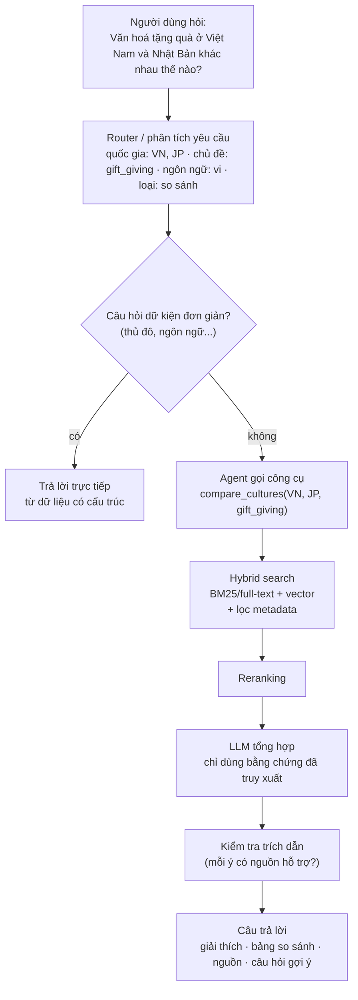
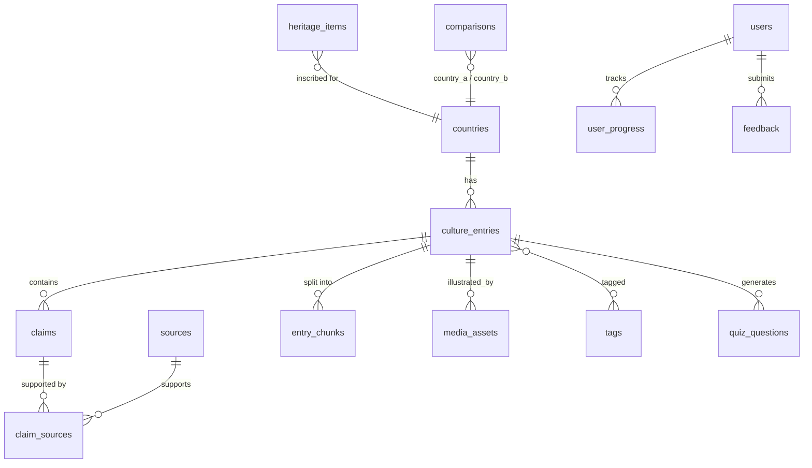
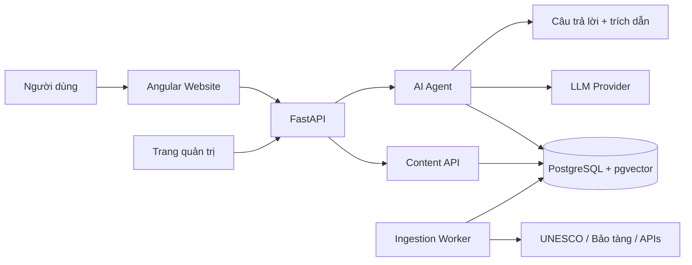

# CultureAtlas AI — Khám phá văn hóa thế giới cùng trí tuệ nhân tạo

> **Khám phá văn hóa · So sánh phong tục · Học hỏi cùng AI**
>
> Một bản đồ văn hóa tương tác, nơi người dùng khám phá các quốc gia, đặt câu hỏi cho AI và tìm hiểu *câu chuyện đằng sau* phong tục, lễ hội, ẩm thực, nghệ thuật và di sản — với mọi câu trả lời đều có nguồn kiểm chứng.

---

## Mục lục

1. [Tầm nhìn và định vị](#1-tầm-nhìn-và-định-vị)
2. [Bài toán và người dùng mục tiêu](#2-bài-toán-và-người-dùng-mục-tiêu)
3. [Tính năng sản phẩm](#3-tính-năng-sản-phẩm)
4. [Phạm vi MVP](#4-phạm-vi-mvp)
5. [Nguồn dữ liệu](#5-nguồn-dữ-liệu)
6. [Mô hình nội dung và quy trình biên tập](#6-mô-hình-nội-dung-và-quy-trình-biên-tập)
7. [Thiết kế AI Cultural Guide Agent](#7-thiết-kế-ai-cultural-guide-agent)
8. [Thiết kế cơ sở dữ liệu](#8-thiết-kế-cơ-sở-dữ-liệu)
9. [Kiến trúc và công nghệ](#9-kiến-trúc-và-công-nghệ)
10. [Thiết kế API](#10-thiết-kế-api)
11. [Đánh giá chất lượng](#11-đánh-giá-chất-lượng)
12. [Lộ trình phát triển](#12-lộ-trình-phát-triển)
13. [Rủi ro và cách xử lý](#13-rủi-ro-và-cách-xử-lý)
14. [Chi phí vận hành ước tính](#14-chi-phí-vận-hành-ước-tính)
15. [Hướng mở rộng](#15-hướng-mở-rộng)

---

## 1. Tầm nhìn và định vị

CultureAtlas AI **không phải** một từ điển văn hóa hay bản sao Wikipedia. Việc liệt kê thông tin về từng quốc gia đã có nhiều nền tảng làm tốt.

Điểm khác biệt của dự án nằm ở ba câu hỏi mà người dùng thực sự quan tâm:

| Câu hỏi | Ví dụ |
|---|---|
| **Vì sao** một nền văn hóa hình thành như vậy? | Vì sao người Nhật cúi chào thay vì bắt tay? |
| **Người dân thực hành** văn hóa đó **như thế nào**? | Quy tắc tặng quà thực tế ở Nhật ra sao, có khác giữa các vùng không? |
| Văn hóa này **khác gì** với văn hóa của tôi? | Văn hóa tặng quà Việt Nam và Nhật Bản khác nhau ở điểm nào? |

**Định vị sản phẩm:** một nền tảng *học tập và khám phá văn hóa* có AI làm hướng dẫn viên, trong đó **AI trò chuyện linh hoạt nhưng kiến thức luôn được kiểm chứng từ nguồn dữ liệu**.

**Nguyên tắc cốt lõi:**

1. **Có nguồn hoặc không khẳng định** — mọi phát biểu thực tế phải gắn với nguồn, hoặc được đánh dấu rõ là chưa kiểm chứng.
2. **Tôn trọng sự đa dạng** — không biến xu hướng phổ biến thành quy tắc áp dụng cho mọi người trong một quốc gia.
3. **Ít mà chắc** — làm tốt vài quốc gia trước, mở rộng theo chất lượng dữ liệu chứ không theo số lượng.
4. **Học qua tương tác** — người dùng hiểu và ghi nhớ, không chỉ đọc.

---

## 2. Bài toán và người dùng mục tiêu

### 2.1. Kịch bản điển hình

Một người Việt Nam chuẩn bị sang Nhật Bản lần đầu. Họ không chỉ muốn biết Nhật có lễ hội gì, mà muốn hỏi:

- Tại sao người Nhật thường cúi chào khi gặp nhau?
- Vì sao một số quy tắc trên bàn ăn lại quan trọng?
- Văn hóa tặng quà ở Nhật khác Việt Nam ở điểm nào?
- Tập quán nào phổ biến toàn quốc, tập quán nào chỉ có ở một vùng hoặc nhóm người?
- Lần đầu đến Nhật, tôi nên tìm hiểu gì để tránh hiểu nhầm văn hóa?

### 2.2. Nhóm người dùng (persona)

| Persona | Nhu cầu chính | Tính năng phù hợp nhất |
|---|---|---|
| **Học sinh, sinh viên** | Học kiến thức văn hóa, địa lý, lịch sử; ôn thi | Explorer, Quiz, Passport |
| **Người chuẩn bị du lịch / du học / làm việc ở nước ngoài** | Hiểu phép lịch sự, tránh hiểu nhầm | AI Guide, Comparison, Scenario |
| **Người làm việc với đối tác quốc tế** | Giao tiếp, đàm phán, tiếp khách đúng mực | Comparison, Scenario |
| **Giáo viên** | Tài liệu giảng dạy có nguồn, bộ câu hỏi cho lớp | Explorer, Quiz (xuất bộ đề) |
| **Người yêu văn hóa** | Khám phá tự do, đọc sâu | Explorer, AI Guide, hiện vật bảo tàng |

> **Gợi ý:** Với MVP, nên chọn **một persona chính** (khuyến nghị: *người chuẩn bị đi nước ngoài* hoặc *sinh viên*) để định hướng nội dung và giao diện, tránh dàn trải.

### 2.3. Ngôn ngữ

- Giao diện và câu trả lời AI: **tiếng Việt và tiếng Anh**.
- Nội dung gốc có thể bằng nhiều ngôn ngữ; AI tổng hợp sang ngôn ngữ của người dùng nhưng **trích dẫn trỏ về nguồn gốc**.

---

## 3. Tính năng sản phẩm

### Tính năng 1 — Cultural Explorer: Bản đồ văn hóa thế giới

Người dùng chọn quốc gia trên bản đồ hoặc tìm theo tên quốc gia, khu vực hay chủ đề.

**Hồ sơ quốc gia gồm:**
- Thông tin nền: thủ đô, khu vực, ngôn ngữ, tiền tệ, quốc gia láng giềng.
- Các danh mục văn hóa: lịch sử khái quát, ẩm thực, lễ hội, nghệ thuật, phong tục & phép lịch sự, trang phục, tôn giáo & tín ngưỡng, di sản (vật thể và phi vật thể).
- Lớp bản đồ di sản: các điểm Di sản Thế giới UNESCO, lọc theo loại văn hóa / thiên nhiên / hỗn hợp.
- Thẻ "Lần đầu đến đây? Hãy biết 5 điều này" — tóm tắt thực hành, có nguồn.

**Bổ sung chi tiết:**
- Khám phá **theo chủ đề xuyên quốc gia**: ví dụ "Tết âm lịch ở châu Á", "Trà trên thế giới", "Nghi lễ trưởng thành".
- Dòng thời gian (timeline) cho lễ hội theo tháng: "Tháng này thế giới có lễ hội gì?"

### Tính năng 2 — AI Cultural Guide: Hướng dẫn viên văn hóa AI ⭐ (cốt lõi)

Chatbot trả lời bằng tiếng Việt hoặc tiếng Anh, hiểu ngữ cảnh hội thoại và **dẫn nguồn cho từng ý**.

- Hỏi tiếp, yêu cầu giải thích đơn giản hơn ("giải thích cho học sinh lớp 6") hoặc sâu hơn.
- Gợi ý 2–3 câu hỏi tiếp theo sau mỗi câu trả lời.
- Hiển thị **mức độ chắc chắn**: *có nguồn trực tiếp* / *suy luận từ nguồn* / *chưa đủ nguồn*.
- Biết **từ chối có lý do** khi kho tri thức chưa có thông tin, và gợi ý nguồn ngoài nên tham khảo.
- Có ngữ cảnh trang: khi đang ở trang Nhật Bản, AI mặc định hiểu câu hỏi liên quan Nhật Bản.

### Tính năng 3 — Culture Comparison: So sánh văn hóa

Chọn hai quốc gia (về sau có thể 3) và một chủ đề, ví dụ Việt Nam – Nhật Bản về chào hỏi, phép lịch sự, ăn uống, lễ hội.

**Kết quả là bảng so sánh có cấu trúc:**

| Thành phần | Mô tả |
|---|---|
| Điểm tương đồng | Có nguồn cho mỗi quốc gia |
| Điểm khác biệt | Có nguồn cho mỗi quốc gia |
| Bối cảnh hình thành | Lịch sử, tôn giáo, địa lý giải thích sự khác biệt |
| Ngoại lệ & lưu ý | Khác biệt vùng miền, thế hệ, bối cảnh trang trọng/thân mật |
| Chưa đủ bằng chứng | Liệt kê rõ những điểm hệ thống không kết luận được |

> **Điều chỉnh:** Kết quả so sánh cho các cặp phổ biến nên được **sinh trước, biên tập viên duyệt và lưu cache**, thay vì luôn sinh mới. Vừa tiết kiệm chi phí, vừa đảm bảo chất lượng cho những nội dung được xem nhiều nhất.

### Tính năng 4 — Cultural Scenario: Học qua tình huống

Người dùng giải quyết tình huống giả lập: ăn tối tại nhà một gia đình nước ngoài, tham gia lễ hội, gặp đối tác lần đầu, đi đám cưới…

- Mỗi bước có 3–4 lựa chọn; AI phản hồi và giải thích vì sao lựa chọn đó phù hợp hoặc gây hiểu nhầm.
- **Khung tình huống do biên tập viên viết sẵn** (cốt truyện, các nút quyết định, đáp án có nguồn); AI chỉ cá nhân hóa lời thoại và giải thích. Cách này tránh việc AI tự bịa ra "quy tắc" văn hóa.
- Kết thúc tình huống: tóm tắt bài học + liên kết bài viết gốc.

### Tính năng 5 — Culture Quiz: Trò chơi kiến thức

- Bộ câu hỏi theo quốc gia, chủ đề và độ khó.
- Giải thích đáp án ngay sau khi chọn, kèm nguồn.
- Thống kê nội dung người học chưa nắm vững.
- AI **sinh câu hỏi nháp** từ bài viết đã duyệt → biên tập viên duyệt → mới xuất bản.
- Dạng câu hỏi: trắc nghiệm, đúng/sai, nối cặp, "đoán quốc gia qua hình ảnh hiện vật".
- Ôn tập ngắt quãng (spaced repetition) cho câu trả lời sai — giai đoạn sau.

### Tính năng 6 — Cultural Passport: Hộ chiếu văn hóa

- Lưu quốc gia đã khám phá, bài học đã hoàn thành, kết quả quiz, sở thích.
- "Đóng dấu" hộ chiếu khi hoàn thành bộ bài học của một quốc gia.
- AI gợi ý chủ đề tiếp theo dựa trên hành trình học.

### Tính năng 7 (bổ sung) — Trang quản trị nội dung

Không phải tính năng cho người dùng cuối nhưng **bắt buộc cho MVP**, vì chất lượng dữ liệu là lõi của sản phẩm:

- Duyệt / sửa / từ chối bài viết, quiz, kết quả so sánh do AI sinh.
- Hàng đợi báo cáo sai sót từ người dùng.
- Xem và sửa thông tin nguồn, giấy phép, ghi công hình ảnh.
- Bảng theo dõi độ phủ dữ liệu theo quốc gia × chủ đề.

---

## 4. Phạm vi MVP

### 4.1. Có trong MVP

| Nhóm | Phạm vi |
|---|---|
| **Cultural Explorer** | Bản đồ + hồ sơ 8–10 quốc gia, 6–8 danh mục mỗi quốc gia |
| **AI Cultural Guide** | RAG song ngữ, trích dẫn, từ chối khi thiếu nguồn |
| **Culture Comparison** | Hai quốc gia × một chủ đề, có nguồn từng ô |
| **Culture Quiz** | Quiz theo quốc gia/chủ đề, câu hỏi đã duyệt |
| **Trang quản trị** | Duyệt nội dung, quản lý nguồn, xử lý báo cáo |

### 4.2. Để sau MVP

- Cultural Scenario (cần nội dung đã ổn định và khung tình huống do người viết).
- Cultural Passport và gợi ý cá nhân hóa (cần tài khoản và dữ liệu hành vi).
- Ứng dụng di động, chế độ offline.

**Lý do:** MVP cần chứng minh ba giá trị trước tiên:
1. Người dùng **tìm được** nội dung đáng tin cậy.
2. Người dùng **hiểu được** nội dung qua AI.
3. Người dùng **ghi nhớ được** kiến thức qua tương tác.

### 4.3. Danh sách quốc gia giai đoạn đầu

Chọn đại diện nhiều khu vực, ưu tiên các quốc gia gần gũi với người dùng Việt Nam:

| Khu vực | Quốc gia |
|---|---|
| Đông Nam Á | Việt Nam, Thái Lan |
| Đông Á | Nhật Bản, Hàn Quốc, Trung Quốc |
| Nam Á | Ấn Độ |
| Châu Âu | Pháp |
| Châu Mỹ | Mexico |
| Trung Đông – Bắc Phi | Ai Cập |
| Châu Phi cận Sahara (khuyến nghị bổ sung) | Nigeria hoặc Kenya |

> **Điều chỉnh:** Danh sách gốc chưa có quốc gia châu Phi cận Sahara. Nên bổ sung ít nhất một quốc gia để bản đồ cân bằng hơn ngay từ MVP.

### 4.4. Danh mục chủ đề thống nhất

Dùng **một bộ danh mục cố định** cho mọi quốc gia để so sánh và đo độ phủ:

`greetings` (chào hỏi) · `etiquette` (phép lịch sự) · `food_dining` (ẩm thực & bàn ăn) · `gift_giving` (tặng quà) · `festivals` (lễ hội) · `religion_beliefs` (tín ngưỡng) · `clothing` (trang phục) · `arts_music` (nghệ thuật & âm nhạc) · `family_life` (gia đình) · `heritage` (di sản) · `business_culture` (văn hóa công sở) · `taboos` (điều kiêng kỵ)

---

## 5. Nguồn dữ liệu

Không cần tự thu thập toàn bộ dữ liệu từ đầu. Tuy nhiên phải phân biệt rõ ba loại:

- **Được phép tái sử dụng và lưu trữ** (theo giấy phép mở).
- **Chỉ được truy cập qua API** (theo điều khoản sử dụng, có thể hạn chế lưu trữ).
- **Hình ảnh có giấy phép riêng từng tài sản.**

> ⚠️ Giấy phép và điều khoản API thay đổi theo thời gian. Thông tin dưới đây là định hướng; **phải kiểm tra lại điều khoản hiện hành** của từng nguồn trước khi nhập dữ liệu vào sản phẩm.

### 5.1. Danh sách nguồn

| # | Nguồn | Loại dữ liệu | Cách dùng | Lưu ý giấy phép |
|---|---|---|---|---|
| 1 | **UNESCO – Di sản văn hóa phi vật thể** (ICH Lists, có trên UNESCO DataHub) | Lễ hội, tập quán, nghệ thuật trình diễn, nghề thủ công; quốc gia; năm ghi danh | Nguồn ưu tiên cho các trang văn hóa và câu trả lời AI | Kiểm tra giấy phép từng tập dữ liệu; phần mô tả, ảnh, video có thể có điều kiện riêng |
| 2 | **UNESCO – Danh sách Di sản Thế giới** (DataHub) | Địa điểm, toạ độ, tiêu chí, năm ghi danh, loại di sản | Bản đồ di sản, trang kiến trúc – lịch sử, quiz | Dataset trên DataHub công bố theo CC BY-SA 4.0 → phải ghi công và chia sẻ tương tự với phần dữ liệu phái sinh |
| 3 | **Smithsonian Open Access** | Metadata và ảnh hiện vật (JSON, API) | Trang hiện vật: trang phục, nhạc cụ, tác phẩm nghệ thuật | Chỉ hiện vật được đánh dấu Open Access (CC0) mới tự do tái sử dụng; liên kết về bản ghi gốc |
| 4 | **Europeana APIs** | Ảnh, sách, bản thảo, báo chí, hiện vật số châu Âu | Tư liệu lịch sử, triển lãm số theo chủ đề | Cần API key miễn phí; metadata thường CC0, **nội dung số có giấy phép riêng từng bản ghi** (trường `rights`) |
| 5 | **REST Countries** | Tên, thủ đô, khu vực, ngôn ngữ, tiền tệ, biên giới | Khởi tạo hồ sơ quốc gia | Kiểm tra phiên bản API và yêu cầu xác thực hiện hành; nên **lưu snapshot** vào DB thay vì gọi trực tiếp lúc chạy |
| 6 | **Wikidata** | Thực thể và quan hệ (SPARQL) | Liên kết quốc gia – lễ hội – địa danh – nhân vật – tác phẩm | CC0; dữ liệu do cộng đồng đóng góp, **không coi là đã kiểm chứng** |
| 7 | **Wikipedia** | Bài viết khái quát | Tham khảo, định hướng biên tập | CC BY-SA; nếu trích nội dung phải ghi công và chia sẻ tương tự |
| 8 | **Wikimedia Commons** | Hình ảnh minh hoạ | Ảnh cho bài viết | Giấy phép khác nhau theo từng tệp; lưu tác giả + giấy phép + URL gốc |
| 9 | **Natural Earth** (bổ sung) | Ranh giới hành chính, bản đồ nền | Dựng bản đồ quốc gia | Public domain |
| 10 | **SCALE Cultural Data** (GitHub, nghiên cứu) | Hiện vật và chủ đề văn hoá ở 29 quốc gia | **Tham khảo cách tổ chức dữ liệu** ban đầu | Kiểm tra giấy phép và cấu trúc tệp trước khi dùng cho sản phẩm |

**Nguồn bổ sung có thể cân nhắc:** trang du lịch / văn hóa chính thức của các chính phủ, tài liệu của bảo tàng quốc gia, đại sứ quán, các nghiên cứu học thuật có thể truy cập mở.

### 5.2. Phương án kết hợp dữ liệu

| Nhu cầu | Nguồn chính | Cách sử dụng |
|---|---|---|
| Danh sách và thông tin quốc gia | REST Countries (+ Wikidata) | Nhập một lần, cập nhật định kỳ |
| Lễ hội, truyền thống, nghề thủ công | UNESCO Intangible Heritage | Nhập và chuẩn hoá |
| Di sản và địa danh lịch sử | UNESCO World Heritage | Nhập dữ liệu địa điểm và ghi danh |
| Hình ảnh, hiện vật | Smithsonian, Europeana, Wikimedia Commons | Chỉ chọn tài sản có giấy phép phù hợp |
| Liên kết giữa các thực thể | Wikidata | Truy vấn và bổ sung quan hệ |
| Phong tục, phép lịch sự, câu chuyện giải thích | Nguồn chính thức + **bài viết biên tập viên tự viết có trích dẫn** | Kho tri thức chính cho AI |
| Bản đồ nền | Natural Earth + thư viện bản đồ | Lớp hiển thị |

> **Nhận xét quan trọng:** Các nguồn mở rất mạnh về *di sản, hiện vật, địa danh*, nhưng **yếu về phong tục đời thường** (chào hỏi, tặng quà, bàn ăn) — chính là phần người dùng hỏi nhiều nhất. Vì vậy MVP cần **ngân sách cho nội dung biên tập** (người viết bài có trích dẫn), không chỉ dựa vào API.

---

## 6. Mô hình nội dung và quy trình biên tập

### 6.1. Đơn vị nội dung: "phát biểu có nguồn" (claim)

Thay vì chỉ lưu bài viết dài, mỗi bài được tách thành các **phát biểu** nhỏ, mỗi phát biểu gắn với một hoặc nhiều nguồn và có thuộc tính phạm vi:

```yaml
claim:
  text: "Khi trao quà ở Nhật Bản, người ta thường dùng hai tay."
  country: JP
  category: gift_giving
  scope: common_practice        # common_practice | historical_tradition | regional | community_specific
  region: null                  # ví dụ "Okinawa" nếu là tập quán vùng
  period: contemporary          # contemporary | historical | <khoảng năm>
  confidence: verified          # verified | partially_supported | unverified
  sources:
    - source_id: 42
      evidence_excerpt: "<đoạn ngắn trong nguồn hỗ trợ phát biểu>"
  reviewed_by: editor_03
  reviewed_at: 2026-11-15
```

Thuộc tính **scope** giúp AI phân biệt *phong tục phổ biến*, *truyền thống lịch sử*, *tập quán vùng miền* và *quy tắc của một cộng đồng cụ thể* — tránh khái quát hoá quá mức.

### 6.2. Vòng đời nội dung

```
draft  →  in_review  →  published  →  (flagged)  →  in_review  →  published / archived
```

- Nội dung do AI sinh (quiz, so sánh, tóm tắt) **luôn bắt đầu ở trạng thái `draft`**.
- Chỉ nội dung `published` mới được dùng làm nguồn truy xuất cho AI Guide.
- Báo cáo sai từ người dùng chuyển nội dung sang `flagged`.

### 6.3. Hướng dẫn biên tập (style guide) — tóm tắt

- Viết bằng ngôn ngữ mô tả, không phán xét ("thường", "nhiều người", "trong bối cảnh trang trọng").
- Luôn nêu phạm vi: toàn quốc, vùng nào, thế hệ nào, bối cảnh nào.
- Tránh khuôn mẫu (stereotype); với chủ đề nhạy cảm (tôn giáo, chính trị, dân tộc thiểu số) ưu tiên nguồn từ chính cộng đồng đó hoặc nguồn học thuật.
- Khi nguồn mâu thuẫn: trình bày các quan điểm, không tự chọn một.
- Ghi rõ ngày cập nhật.

---

## 7. Thiết kế AI Cultural Guide Agent

Đây là phần quan trọng nhất của dự án. Không chỉ gắn một chatbot vào website, mà xây dựng **Agent biết tìm dữ liệu, đối chiếu nguồn, so sánh và tạo hoạt động học tập**.

### 7.1. Kiến trúc RAG

RAG (Retrieval-Augmented Generation) cho phép AI truy xuất nội dung liên quan **trước** khi trả lời, thay vì dựa vào kiến thức sẵn có của mô hình.



### 7.2. Pipeline dữ liệu cho RAG

| Bước | Mô tả | Chi tiết kỹ thuật |
|---|---|---|
| 1. **Ingestion** | Lấy dữ liệu qua API hoặc dataset | Lưu bản gốc (raw JSON) + giấy phép + thời điểm lấy |
| 2. **Chuẩn hoá** | Loại trùng, tách metadata, ánh xạ quốc gia (ISO 3166) và danh mục | Khử trùng theo ID nguồn + so khớp tiêu đề gần đúng |
| 3. **Chunking** | Chia nội dung thành đoạn | ~300–500 token, chồng lấn ~10–15%; ưu tiên cắt theo phát biểu/đoạn văn; mỗi chunk mang metadata (quốc gia, danh mục, scope, ngôn ngữ, source_id) |
| 4. **Embedding** | Vector đa ngôn ngữ | Mô hình embedding hỗ trợ tốt tiếng Việt và tiếng Anh (ví dụ họ BGE-M3, multilingual-E5 hoặc API embedding đa ngôn ngữ); **benchmark trên dữ liệu tiếng Việt thật trước khi chọn** |
| 5. **Retrieval** | Kết hợp từ khoá + ngữ nghĩa | PostgreSQL full-text search + pgvector; gộp kết quả bằng Reciprocal Rank Fusion; lọc theo quốc gia/danh mục/trạng thái `published` |
| 6. **Reranking** | Sắp xếp lại top-k | Cross-encoder đa ngôn ngữ; giữ 5–8 đoạn tốt nhất |
| 7. **Generation** | LLM tổng hợp | Prompt yêu cầu trích dẫn theo ID đoạn; định dạng đầu ra có cấu trúc (JSON) |
| 8. **Verification** | Kiểm tra sau sinh | Mỗi câu có trích dẫn phải trỏ đến đoạn thực sự được truy xuất; có thể dùng bước LLM-judge nhẹ để kiểm tra "đoạn này có hỗ trợ câu này không" |
| 9. **Feedback** | Học từ người dùng | Lưu 👍/👎, báo cáo sai, câu hỏi không trả lời được → hàng đợi biên tập |

**Lưu ý về đa ngôn ngữ:** Người dùng hỏi tiếng Việt nhưng nguồn chủ yếu tiếng Anh. Có hai cách:
- Dùng embedding đa ngôn ngữ (truy xuất xuyên ngôn ngữ trực tiếp), **hoặc**
- Dịch câu hỏi sang tiếng Anh trước khi truy xuất từ khoá, rồi gộp kết quả.

Khuyến nghị kết hợp cả hai cho tìm kiếm từ khoá, vì full-text search không hoạt động xuyên ngôn ngữ.

### 7.3. Công cụ (tools) của Agent

Bắt đầu với **một Agent gọi công cụ chuyên biệt**, chưa cần kiến trúc đa Agent.

| Tool | Đầu vào | Chức năng |
|---|---|---|
| `search_culture` | query, country?, category?, language? | Tìm kiếm hybrid trong kho tri thức |
| `get_country_profile` | country_code | Thông tin có cấu trúc của quốc gia |
| `compare_cultures` | country_a, country_b, topic | Truy xuất bằng chứng **riêng cho từng quốc gia** rồi tạo bảng đối chiếu |
| `get_heritage_items` | country, type? | Di sản UNESCO (vật thể/phi vật thể) |
| `get_artifacts` | country?, keyword | Hiện vật bảo tàng có giấy phép phù hợp |
| `generate_quiz` | entry_ids, difficulty, n | Sinh câu hỏi nháp từ bài viết đã duyệt |
| `recommend_learning_path` | user_id | Gợi ý chủ đề theo lịch sử học (giai đoạn 4) |
| `get_source_details` | source_id | Tiêu đề, URL, nhà xuất bản, giấy phép, ngày truy xuất |

**Ví dụ:** khi người dùng muốn so sánh tặng quà, Agent gọi `compare_cultures("VN", "JP", "gift_giving")`. Công cụ truy xuất bằng chứng cho từng quốc gia, rồi mới yêu cầu LLM lập bảng. **Nếu không đủ bằng chứng cho một điểm, ô đó hiển thị "chưa đủ nguồn để kết luận"** thay vì để LLM tự lấp đầy.

### 7.4. Prompt hệ thống (khung tham khảo)

```text
Bạn là CultureAtlas Guide, hướng dẫn viên văn hoá.
Quy tắc:
1. Chỉ đưa ra phát biểu thực tế khi có trong BẰNG CHỨNG được cung cấp. Gắn [id] cho mỗi ý.
2. Nếu bằng chứng không đủ, nói rõ "Kho dữ liệu hiện chưa có đủ nguồn về ..." và gợi ý hướng tìm hiểu.
3. Nêu phạm vi: phổ biến / vùng miền / lịch sử / một cộng đồng cụ thể. Không khái quát hoá cho cả quốc gia.
4. Khi các nguồn mâu thuẫn, trình bày cả hai.
5. Giọng văn tôn trọng, không phán xét văn hoá nào hơn văn hoá nào.
6. Trả lời bằng ngôn ngữ của người dùng. Kết thúc bằng 2–3 câu hỏi gợi ý tìm hiểu tiếp.
```

### 7.5. Hạn chế AI trả lời sai về văn hoá

Văn hoá khác nhau theo vùng miền, thế hệ, tôn giáo, hoàn cảnh và thời kỳ. Nguyên tắc hệ thống:

- Mọi phát biểu thực tế phải có nguồn **hoặc** được đánh dấu chưa kiểm chứng.
- Phân biệt phong tục phổ biến, truyền thống lịch sử và quy tắc của cộng đồng cụ thể (trường `scope`).
- Ưu tiên nguồn chính thức, bảo tàng, nghiên cứu có xuất xứ rõ ràng (trường `reliability_tier` của nguồn).
- Khi nguồn mâu thuẫn, trình bày sự khác nhau.
- Hiển thị nguồn gốc, thời gian cập nhật và giấy phép.
- Cho phép báo cáo câu trả lời sai.
- **Guardrail đầu vào:** phát hiện câu hỏi mang tính khuôn mẫu hoặc xúc phạm ("người nước X đều …") và trả lời theo hướng điều chỉnh nhận thức, có nguồn.
- **Guardrail chủ đề nhạy cảm:** chính trị, xung đột lãnh thổ, tôn giáo — trả lời trung lập, dẫn nhiều nguồn, tránh kết luận.

> Chỉ số quan trọng: **tỷ lệ câu trả lời có nguồn hỗ trợ thực sự**, không phải tỷ lệ câu trả lời có gắn đường dẫn.

### 7.6. Tối ưu chi phí và độ trễ

- Câu hỏi dữ kiện (thủ đô, ngôn ngữ, tiền tệ) → trả lời từ dữ liệu có cấu trúc, **không gọi LLM**.
- Cache câu trả lời cho câu hỏi lặp lại (theo embedding gần trùng + cùng ngữ cảnh).
- Dùng mô hình nhỏ cho router/phân loại, mô hình lớn hơn cho tổng hợp.
- Streaming câu trả lời để giảm độ trễ cảm nhận.
- Giới hạn số lượt hỏi/ngày với người dùng chưa đăng nhập.

---

## 8. Thiết kế cơ sở dữ liệu

Dùng **PostgreSQL + pgvector** — một cơ sở dữ liệu cho cả dữ liệu quan hệ, tìm kiếm toàn văn và vector, chưa cần vector database riêng.

### 8.1. Sơ đồ quan hệ



### 8.2. Các bảng cốt lõi

| Bảng | Trường chính | Mục đích |
|---|---|---|
| `countries` | id, iso_code (ISO 3166-1 alpha-2/3), name_vi, name_en, region, subregion, capital, languages (JSONB), currencies (JSONB), geometry_ref, raw_data (JSONB) | Hồ sơ quốc gia |
| `culture_entries` | id, country_id, category, title_vi, title_en, summary, content, scope, region, period, status, version, updated_at | Bài viết văn hoá |
| `claims` | id, entry_id, text, scope, region, period, confidence, status | Phát biểu có thể kiểm chứng |
| `sources` | id, title, publisher, source_url, source_type, license, reliability_tier, retrieved_at, raw_ref | Theo dõi nguồn và quyền sử dụng |
| `claim_sources` | claim_id, source_id, evidence_excerpt, locator (trang/đoạn) | Liên kết phát biểu ↔ nguồn |
| `heritage_items` | id, unesco_id, country_ids, name, type (tangible/intangible), list_type, inscribed_year, criteria, lat, lng, source_id | Di sản UNESCO |
| `media_assets` | id, entry_id, url, stored_url?, author, license, attribution_text, source_url, verified | Hình ảnh / hiện vật |
| `tags` + `entry_tags` | id, name, category | Phân loại, khám phá theo chủ đề |
| `entry_chunks` | id, entry_id, chunk_text, language, metadata (JSONB), tsv (tsvector), embedding (vector) | RAG: tìm kiếm toàn văn + vector |
| `comparisons` | id, country_a, country_b, topic, result (JSONB), status, reviewed_by | Kết quả so sánh đã duyệt / cache |
| `quiz_questions` | id, entry_id, question, options (JSONB), answer, explanation, difficulty, status | Hoạt động học |
| `users` | id, email, locale, preferences (JSONB) | Tài khoản (giai đoạn 4) |
| `user_progress` | user_id, entry_id, quiz_score, completed_at | Hành trình học |
| `chat_logs` | id, session_id, question, answer, cited_chunk_ids, latency_ms, model, rating | Phân tích, đánh giá, cải tiến |
| `feedback` | id, target_type, target_id, user_id, type, comment, status | Báo cáo sai / góp ý |
| `ingestion_runs` | id, source_name, started_at, finished_at, records_in, records_changed, errors | Theo dõi đồng bộ dữ liệu |

### 8.3. Nguyên tắc thiết kế

- **Không gộp nội dung và nguồn vào một trường văn bản.** Phải biết mỗi phát biểu dựa vào nguồn nào để sửa lỗi, cập nhật và trích dẫn chính xác.
- Khoá ngoại cho các bảng quan hệ; JSONB cho metadata linh hoạt từ API.
- Lưu `raw_data` từ API để có thể chuẩn hoá lại mà không cần gọi lại.
- **Versioning nội dung:** lưu lịch sử chỉnh sửa (bảng `entry_revisions` hoặc trường `version`) để truy vết.
- Chỉ mục: HNSW cho cột `embedding`, GIN cho `tsv` và các cột JSONB thường lọc.
- Tiếng Việt trong full-text search: cấu hình `simple` + chuẩn hoá bỏ dấu (`unaccent`) để tìm được cả khi người dùng gõ không dấu.

---

## 9. Kiến trúc và công nghệ

Kiến trúc **vừa đủ để triển khai nhanh nhưng có thể mở rộng**.

### 9.1. Lựa chọn công nghệ

| Thành phần | Công nghệ | Ghi chú |
|---|---|---|
| **Frontend** | Angular + TypeScript | Tận dụng kinh nghiệm sẵn có; bật SSR (Angular SSR) để trang quốc gia được Google index tốt |
| **Bản đồ** | MapLibre GL hoặc Leaflet + dữ liệu Natural Earth | Miễn phí, không phụ thuộc nhà cung cấp bản đồ trả phí |
| **Backend** | FastAPI + Python | REST API, xác thực, điều phối Agent; tách router `/content` và `/ai` |
| **Cơ sở dữ liệu** | PostgreSQL 16+ + pgvector | Dữ liệu quan hệ, full-text, vector |
| **LLM** | Một LLM API qua lớp trừu tượng (adapter) | Dễ đổi nhà cung cấp hoặc chuyển sang mô hình tự triển khai |
| **Embedding** | Mô hình đa ngôn ngữ (Việt – Anh) | Benchmark trước khi chọn |
| **Worker** | Python + cron / APScheduler (MVP) → Celery/RQ khi cần | Đồng bộ API, làm sạch, tạo embedding |
| **Lưu trữ ảnh** | Object storage (S3-compatible) | Chỉ lưu ảnh đã xác minh giấy phép; còn lại liên kết nguồn gốc |
| **Quan sát (observability)** | Logging có cấu trúc + công cụ tracing LLM (ví dụ Langfuse) | Theo dõi prompt, độ trễ, chi phí, trích dẫn |
| **Triển khai** | Docker Compose | Frontend, backend, PostgreSQL, worker |
| **CI/CD** | GitHub Actions | Test, lint, **chạy bộ benchmark RAG khi thay đổi prompt/pipeline** |

### 9.2. Luồng tổng quát



### 9.3. Nguyên tắc hạ tầng

- Giai đoạn đầu: **một backend, một cơ sở dữ liệu, một worker**.
- Chỉ thêm Redis, hàng đợi tác vụ, nhiều dịch vụ AI **khi số liệu cho thấy cần thiết**.
- Không gọi API bên ngoài (REST Countries, UNESCO…) trong luồng người dùng — mọi dữ liệu đi qua worker → DB.

---

## 10. Thiết kế API

### 10.1. Content API (không dùng LLM)

| Method | Endpoint | Mô tả |
|---|---|---|
| GET | `/api/countries` | Danh sách quốc gia, lọc theo khu vực |
| GET | `/api/countries/{iso}` | Hồ sơ quốc gia |
| GET | `/api/countries/{iso}/entries?category=` | Bài viết theo danh mục |
| GET | `/api/entries/{id}` | Chi tiết bài viết + phát biểu + nguồn |
| GET | `/api/heritage?country=&type=` | Di sản UNESCO |
| GET | `/api/search?q=&country=&category=` | Tìm kiếm nội dung |
| GET | `/api/sources/{id}` | Chi tiết nguồn, giấy phép |
| GET | `/api/quizzes?country=&category=&difficulty=` | Lấy bộ câu hỏi |
| POST | `/api/feedback` | Báo cáo sai / góp ý |

### 10.2. AI API

| Method | Endpoint | Mô tả |
|---|---|---|
| POST | `/api/ai/chat` | Hỏi đáp (streaming SSE); body gồm `message`, `session_id`, `context` (trang hiện tại) |
| POST | `/api/ai/compare` | So sánh hai quốc gia × chủ đề (trả cache đã duyệt nếu có) |

**Định dạng câu trả lời chat (rút gọn):**

```json
{
  "answer": "Ở Nhật Bản, quà thường được trao bằng hai tay [c1] ...",
  "citations": [
    { "id": "c1", "source_id": 42, "title": "...", "url": "...", "excerpt": "..." }
  ],
  "confidence": "supported",
  "follow_up_questions": ["...", "..."],
  "unsupported_points": []
}
```

### 10.3. Admin API

Duyệt nội dung, quản lý nguồn, xử lý feedback, kích hoạt đồng bộ dữ liệu — có phân quyền (`editor`, `admin`).

---

## 11. Đánh giá chất lượng

Không chỉ đo số trang hay việc chatbot có trả lời được không, mà đo **chất lượng dữ liệu** và **chất lượng AI**.

### 11.1. Chỉ số

| Nhóm | Chỉ số | Cách kiểm tra | Mục tiêu MVP (gợi ý) |
|---|---|---|---|
| Nội dung | Độ chính xác bài viết | Biên tập viên đối chiếu nguồn | ≥ 95% phát biểu đúng |
| Nội dung | Độ phủ | % ô (quốc gia × danh mục) có ≥ 3 phát biểu đã duyệt | ≥ 80% |
| AI | **Citation correctness** | Nguồn có thực sự hỗ trợ phát biểu? | ≥ 90% |
| AI | Retrieval recall@k | Tài liệu liên quan có trong top-k? | ≥ 85% (k = 8) |
| AI | Tỷ lệ trả lời có căn cứ | % câu trả lời thực tế được nguồn hỗ trợ | ≥ 90% |
| AI | Tỷ lệ từ chối đúng | Với câu hỏi không có nguồn, AI có thừa nhận thiếu dữ liệu? | ≥ 90% |
| AI | Độ trễ | p95 thời gian đến token đầu tiên | < 3 giây |
| Người dùng | Mức độ hữu ích | Tỷ lệ 👍 / tổng đánh giá | ≥ 75% |
| Người dùng | Tương tác | Tỷ lệ hoàn thành quiz, số trang quốc gia/phiên, tỷ lệ quay lại 7 ngày | Theo dõi xu hướng |

### 11.2. Bộ benchmark

Xây dựng bộ **100–150 câu hỏi** có đáp án tham chiếu và nguồn kỳ vọng, chia nhóm:

| Nhóm | Tỷ lệ | Ví dụ |
|---|---|---|
| Tra cứu dữ kiện | 15% | "Ngôn ngữ chính thức của Ấn Độ?" |
| Giải thích phong tục | 30% | "Vì sao người Thái chào bằng cách chắp tay?" |
| So sánh quốc gia | 20% | "Chào hỏi ở Pháp và Việt Nam khác nhau thế nào?" |
| Câu hỏi mơ hồ | 10% | "Người châu Á ăn uống thế nào?" |
| Không có đủ nguồn | 15% | Hỏi về tập quán của một làng cụ thể |
| Câu hỏi khuôn mẫu / nhạy cảm | 10% | "Có phải người nước X đều …?" |

- **Đánh giá thủ công** một tập tham chiếu trước, rồi mới hiệu chỉnh và tin vào điểm của LLM-judge.
- Chạy benchmark tự động trong CI mỗi khi đổi prompt, mô hình, chunking hoặc embedding.

---

## 12. Lộ trình phát triển

Ước lượng cho nhóm nhỏ (2–3 người); điều chỉnh theo nguồn lực thực tế.

### Giai đoạn 0 — Chuẩn bị (1–2 tuần)
- Chốt persona chính, danh sách quốc gia, bộ danh mục.
- Kiểm tra giấy phép từng nguồn dữ liệu; viết style guide biên tập.
- Dựng khung dự án: repo, Docker Compose, CI.

### Giai đoạn 1 — Nền tảng dữ liệu (3–5 tuần)
- Worker nhập REST Countries, UNESCO (vật thể + phi vật thể), Natural Earth.
- Viết/biên tập nội dung phong tục cho 8–10 quốc gia × các danh mục chính, có trích dẫn.
- Trang bản đồ, hồ sơ quốc gia, trang bài viết, trang quản trị cơ bản.

**Kết quả:** website có bản đồ, trang quốc gia và nội dung mẫu được dẫn nguồn đầy đủ.

### Giai đoạn 2 — AI Cultural Guide (4–6 tuần)
- Chunking, embedding, hybrid search, reranking.
- Agent với `search_culture`, `get_country_profile`, `get_source_details`.
- Giao diện chat có trích dẫn, streaming, gợi ý câu hỏi.
- Bộ benchmark v1 + quy trình đánh giá.

**Kết quả:** người dùng hỏi đáp dựa trên kho tri thức, có trích dẫn kiểm chứng được.

### Giai đoạn 3 — So sánh và kiểm tra kiến thức (3–4 tuần)
- `compare_cultures` + giao diện bảng so sánh + cache đã duyệt.
- Sinh quiz nháp → duyệt → xuất bản; giao diện quiz và giải thích.
- **Ra mắt MVP / beta công khai.**

**Kết quả:** người dùng chủ động học, so sánh và kiểm tra hiểu biết.

### Giai đoạn 4 — Cá nhân hoá và mở rộng (liên tục)
- Tài khoản, Cultural Passport, gợi ý lộ trình học.
- Cultural Scenario với khung tình huống do biên tập viên viết.
- Đồng bộ dữ liệu tự động có kiểm soát; mở rộng quốc gia theo dữ liệu.
- Hiện vật bảo tàng (Smithsonian, Europeana).

**Kết quả:** nền tảng khám phá văn hoá mở rộng được theo chủ đề và khu vực.

---

## 13. Rủi ro và cách xử lý

| # | Rủi ro | Tác động | Cách xử lý |
|---|---|---|---|
| 1 | **Nội dung không cân bằng giữa các quốc gia** — nơi nhiều tài liệu số được đại diện nhiều hơn | Sai lệch nhận thức, thiếu công bằng | Dashboard độ phủ theo khu vực × nguồn × chủ đề; đặt mức tối thiểu mỗi quốc gia; chủ động bổ sung nguồn cho cộng đồng ít được ghi chép |
| 2 | **Bản quyền hình ảnh và nội dung** | Rủi ro pháp lý | Lưu giấy phép, tác giả, URL gốc, yêu cầu ghi công cho mọi tài sản; chưa xác minh → chỉ liên kết, không sao chép; tôn trọng điều kiện "chia sẻ tương tự" (CC BY-SA) |
| 3 | **AI tạo giải thích nghe hợp lý nhưng sai** | Mất niềm tin — rủi ro lớn nhất với sản phẩm giáo dục | RAG + kiểm tra trích dẫn sau sinh; benchmark định kỳ; AI được phép nói "chưa đủ nguồn"; báo cáo sai từ người dùng |
| 4 | **Khuôn mẫu, định kiến văn hoá** | Gây phản cảm, tổn hại uy tín | Trường `scope` cho mọi phát biểu; style guide; guardrail câu hỏi định kiến; mời người bản xứ review nội dung quốc gia của họ |
| 5 | **Chủ đề nhạy cảm** (tôn giáo, chính trị, lãnh thổ tranh chấp) | Tranh cãi, rủi ro pháp lý ở một số thị trường | Trả lời trung lập, nhiều nguồn; xử lý cẩn thận ranh giới trên bản đồ (ghi chú nguồn bản đồ) |
| 6 | **Chi phí LLM tăng theo lượng người dùng** | Không bền vững | Trả lời dữ kiện không qua LLM; cache; mô hình nhỏ cho router; giới hạn lượt hỏi |
| 7 | **Nguồn API thay đổi hoặc ngừng hoạt động** | Gián đoạn dữ liệu | Lưu snapshot vào DB; không gọi API ngoài trong luồng người dùng; theo dõi `ingestion_runs` |
| 8 | **Thiếu nguồn lực biên tập** | Nội dung mỏng, AI không có gì để truy xuất | Bắt đầu ít quốc gia; ưu tiên danh mục người dùng hỏi nhiều (dựa trên log); cân nhắc cộng tác với giáo viên/sinh viên ngành văn hoá học |
| 9 | **Lạm dụng chatbot** (prompt injection, hỏi ngoài phạm vi) | Chi phí, nội dung không phù hợp | Giới hạn phạm vi chủ đề; rate limit; lọc đầu vào/đầu ra |

---

## 14. Chi phí vận hành ước tính

Ước tính sơ bộ cho giai đoạn MVP, quy mô vài nghìn người dùng/tháng (con số thực tế phụ thuộc nhà cung cấp và mức sử dụng — cần tính lại khi chọn dịch vụ):

| Hạng mục | Ghi chú |
|---|---|
| Máy chủ (VPS chạy Docker Compose) | Một máy cấu hình trung bình là đủ cho MVP |
| PostgreSQL | Chạy chung máy chủ hoặc dịch vụ managed gói nhỏ |
| LLM API | Khoản biến động lớn nhất; kiểm soát bằng cache, router, rate limit |
| Embedding | Chi phí một lần khi lập chỉ mục + nhỏ khi cập nhật; có thể tự chạy mô hình mã nguồn mở |
| Object storage + CDN | Nhỏ nếu chỉ lưu ảnh đã xác minh |
| Tên miền, SSL | Không đáng kể |
| **Biên tập nội dung** | Thường là chi phí lớn nhất về thời gian — cần lên kế hoạch rõ |

---

## 15. Hướng mở rộng

- **Đóng góp cộng đồng có kiểm duyệt:** người dùng bản xứ đề xuất chỉnh sửa, biên tập viên duyệt.
- **Chế độ dành cho giáo viên:** tạo lớp, giao bộ quiz, xuất tài liệu.
- **Lộ trình "Chuẩn bị chuyến đi":** nhập quốc gia + mục đích (du lịch, du học, công tác) → AI tạo checklist văn hoá có nguồn.
- **Lịch lễ hội thế giới** theo tháng, có thông báo.
- **Đa phương tiện:** âm thanh phát âm lời chào, nhạc cụ truyền thống (nguồn có giấy phép).
- **Ứng dụng di động** và chế độ offline cho hồ sơ quốc gia.
- **Mô hình tự triển khai** khi chi phí hoặc yêu cầu riêng tư đòi hỏi.

---

## Kết luận

CultureAtlas AI nên được định vị là **nền tảng học tập và khám phá văn hoá có AI hỗ trợ**, không phải một từ điển văn hoá.

MVP lý tưởng gồm: trang khám phá quốc gia, nội dung văn hoá có nguồn, chatbot RAG có trích dẫn, bảng so sánh hai quốc gia, quiz và trang quản trị dữ liệu — làm tốt 8–10 quốc gia trước, mở rộng theo chất lượng dữ liệu thực tế.

Điểm khác biệt **không nằm ở mô hình AI lớn nhất**, mà ở khả năng kết hợp:

1. dữ liệu có nguồn gốc và quyền sử dụng rõ ràng,
2. truy xuất chính xác,
3. giải thích theo ngữ cảnh, tôn trọng sự đa dạng,
4. trải nghiệm học tập tương tác và cá nhân hoá.

Đây cũng là cách thể hiện năng lực xây dựng **một hệ thống AI thực tế**, thay vì chỉ tích hợp một API chatbot vào website.
