# CultureAtlas AI

CultureAtlas AI helps learners explore world cultures, understand *why* customs exist, and compare them with their own culture. It combines an interactive culture map, country profiles built from source-backed claims, an AI Cultural Guide that cites every statement, side-by-side culture comparisons, quizzes, and an editorial back office that keeps the knowledge base trustworthy.

## 1. Requirements — INVEST, Use Cases, and Acceptance Criteria

Requirements define what CultureAtlas AI must do, who uses it, the value delivered, and the observable conditions of success. User stories are reviewed with INVEST and mapped to use cases and acceptance criteria. The guiding rule across all requirements is **"cite a source or don't claim it"**.

### 1.1 Product mind map

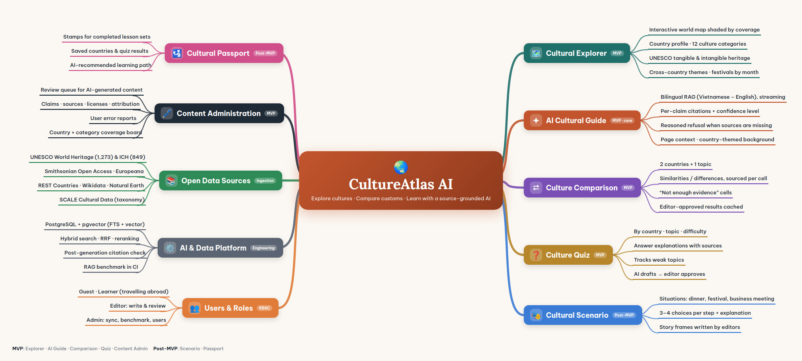

Editable source: [docs/mindmap.xmind](docs/mindmap.xmind) (XMind).

### 1.2 INVEST requirements

The V1 backlog includes 20 user stories. These stories cover the culture map, country profiles, source-backed claims, UNESCO heritage, search, the AI Cultural Guide, culture comparison, quizzes, error reporting, content review, source management, coverage tracking, and data ingestion.
Before a user story is ready for development, it is checked using the INVEST criteria.

| Criterion       | Meaning in CultureAtlas AI                                                                                                     |
| --------------- | ------------------------------------------------------------------------------------------------------------------------------ |
| **Independent** | Each story delivers a clear capability and depends on other stories only when necessary (e.g. published claims can be seeded). |
| **Negotiable**  | UI, ranking algorithms, and models can change as long as the goal and the "cite a source or don't claim it" rule stay intact.  |
| **Valuable**    | Each story helps learners understand, compare, or remember a culture, or helps editors keep content accurate and licensed.     |
| **Estimable**   | Roles, inputs, outputs, API endpoints, tables, dependencies, and failure outcomes (including missing evidence) are documented.  |
| **Small**       | Each story covers one primary capability and can be split into UI, API, retrieval, persistence, and test tasks within a sprint. |
| **Testable**    | Every story maps to observable acceptance criteria, including insufficient-source, authorization, and validation behavior.     |

```text
US01–US05   Cultural Explorer (map, country profile, claims, UNESCO heritage, search)
US06–US10   AI Cultural Guide (streaming answers, citations, refusal, page context, feedback)
US11        Culture Comparison
US12–US13   Culture Quiz
US14        Error reporting
US15–US19   Content administration (sign-in, review, claims, sources, coverage)
US20        Data ingestion
```

All V1 stories have estimable target behavior. AI-generated content always starts as a draft, comparison cells without evidence show "not enough evidence", and the AI Guide answers simple facts from structured data without calling the LLM. The complete story-level review is maintained in [INVEST Requirements](docs/08-invest-requirements.md).

### 1.3 Use cases

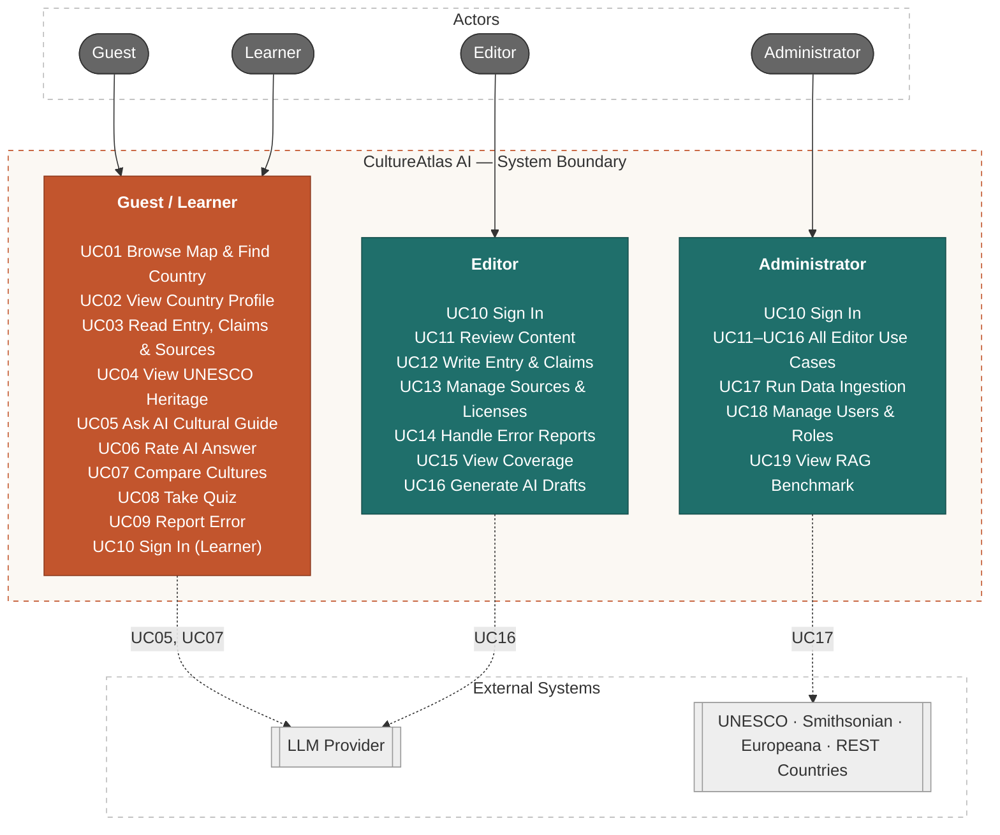

For detailed actors, permissions, and business flows, see [Actors, roles, and use cases](docs/03-use-cases.md).

### 1.4 Roles and permissions

| Capability                                   | Guest        | Learner         | Editor | Admin |
| -------------------------------------------- | ------------ | --------------- | ------ | ----- |
| Browse map, country profiles, heritage       | Yes          | Yes             | Yes    | Yes   |
| Ask the AI Cultural Guide                    | 10 per day   | Higher limit    | Yes    | Yes   |
| Compare cultures, take quizzes               | Yes          | Yes             | Yes    | Yes   |
| Report errors, rate answers                  | Yes          | Yes             | Yes    | Yes   |
| Save progress / Cultural Passport (post-MVP) | No           | Yes             | No     | No    |
| View draft and in-review content             | No           | No              | Yes    | Yes   |
| Write, review, and publish content           | No           | No              | Yes    | Yes   |
| Manage sources, media, and error reports     | No           | No              | Yes    | Yes   |
| Run data ingestion and RAG benchmark         | No           | No              | No     | Yes   |
| User management                              | No           | No              | No     | Yes   |

The backend must enforce RBAC and the published-only rule for public content; hiding frontend controls serves UI/UX only.

## 2. Information Architecture, Screen Hierarchy, and UI/UX

The information architecture uses **country as the primary axis and topic as the secondary axis**: every piece of content sits on a country × category grid, so navigation, comparison, and coverage tracking share one structure. Sources are always one click away, and the AI Guide is reachable from every content page. Loading, empty, insufficient-source, unreviewed, error, and forbidden states are defined consistently.

### 2.1 Information architecture

```text
Public
├── Explore (map, destinations, themes, festivals this month)
├── Country Profile
│   └── Entry (claims + sources)
├── Theme
├── UNESCO Heritage
├── AI Cultural Guide
├── Culture Comparison
├── Quiz
│   └── Quiz Session
├── Source Detail
└── Sign In

Editorial (Editor / Admin)
├── Review Queue
├── Entries & Claims
├── Sources & Licenses
├── Media & Attribution
├── Error Reports
├── Coverage
├── Data Ingestion      (Admin)
├── RAG Benchmark       (Admin)
├── Users & Roles       (Admin)
└── Forbidden
```

### 2.2 Screen hierarchy

Explore leads to country profiles, themes, and the AI Guide. A country profile opens entries, UNESCO heritage, the AI Guide with the country as context, and a comparison with Vietnam. Every citation chip opens the source detail with its excerpt and license. Quiz results link back to the original entry. Sign-in leads editors to the review queue, which opens the entry/claim editor and source management. Unauthorized navigation resolves to the Forbidden screen.

Detailed screen IDs, user flows, screen states, the design system, and API mappings are maintained in [Information Architecture](docs/04-information-architecture.md).

### 2.3 Current UI prototype

The Angular prototype uses sample custom-and-etiquette content plus **real data snapshots** from UNESCO DataHub (World Heritage and Intangible Heritage lists), Smithsonian Open Access, Europeana, and SCALE. Every country, feature, theme, and festival is illustrated with an openly licensed Wikimedia Commons photo, credited on the image ([credits](src/frontend/public/images/culture/credits.json)).

#### Explore

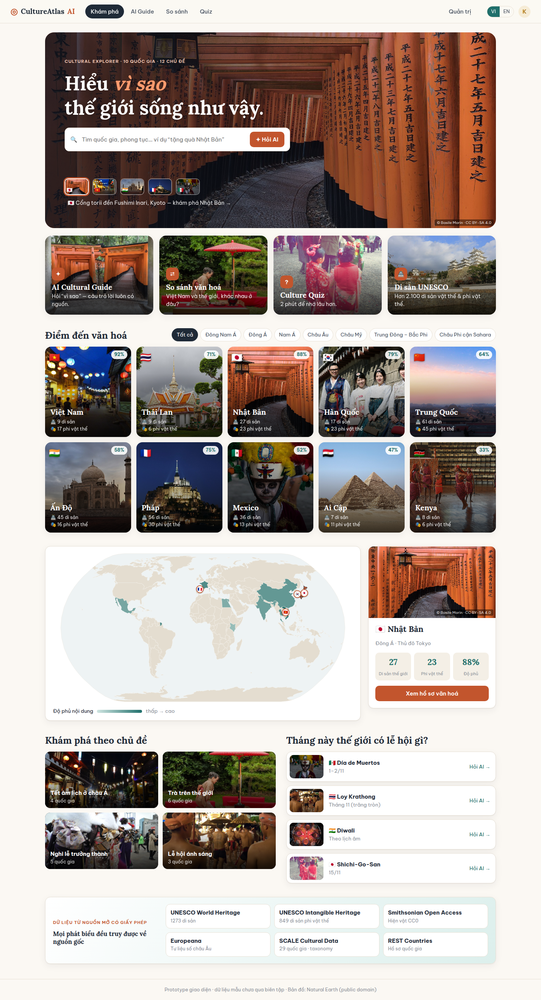

#### Country profile

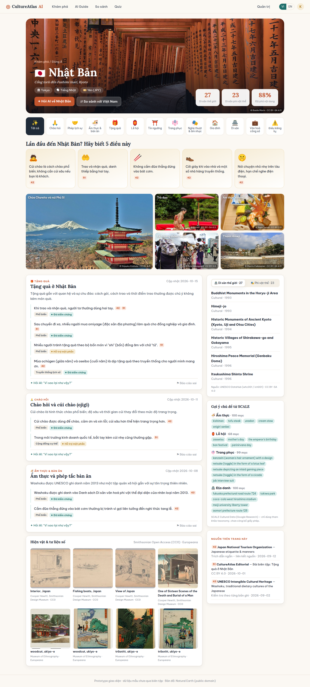

#### AI Cultural Guide

The background follows the countries mentioned in the conversation: one country fills the screen, two countries split it.

| Vietnam vs. Japan | India (Diwali) | France (dining) |
| --- | --- | --- |
| 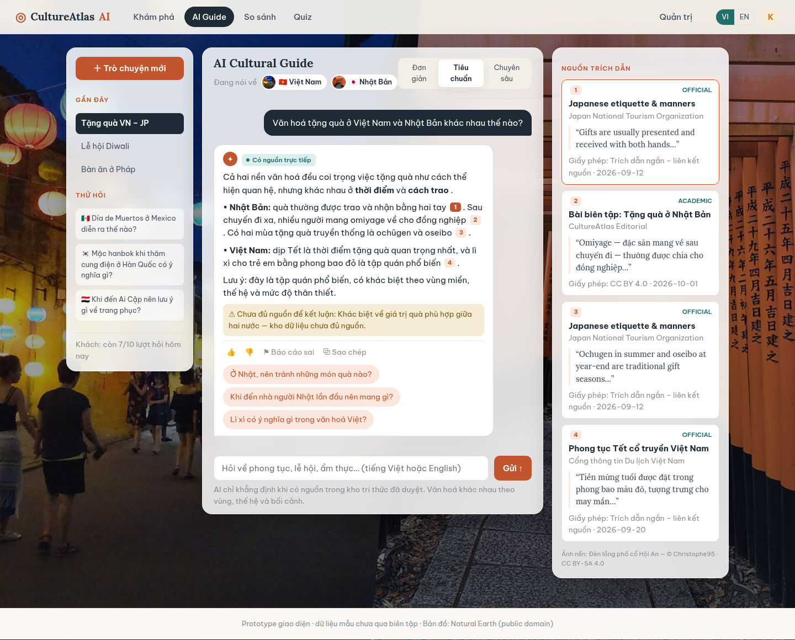 | 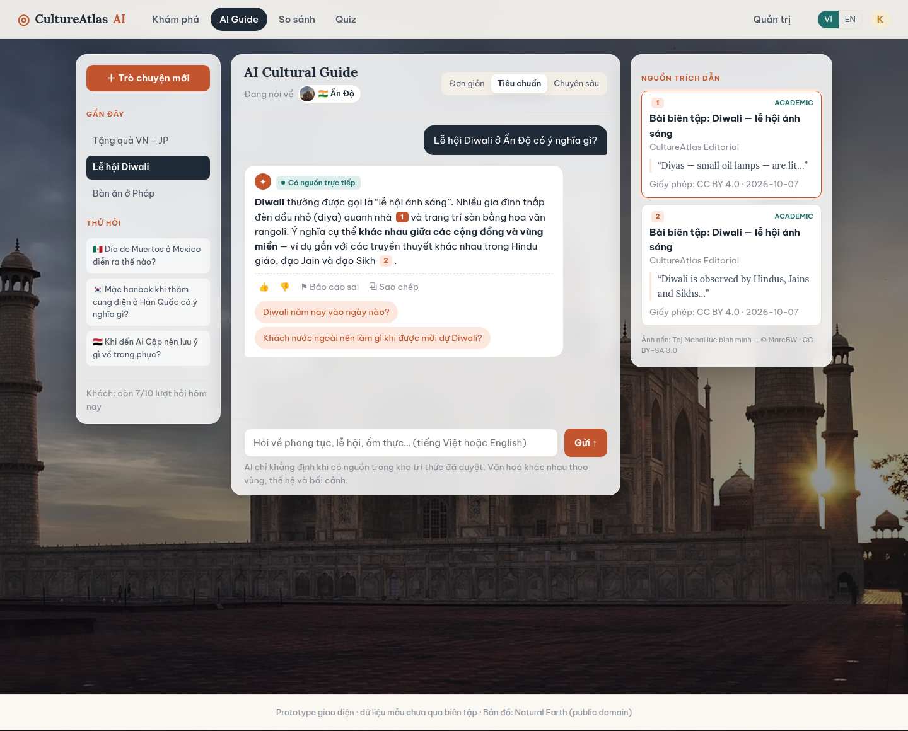 | 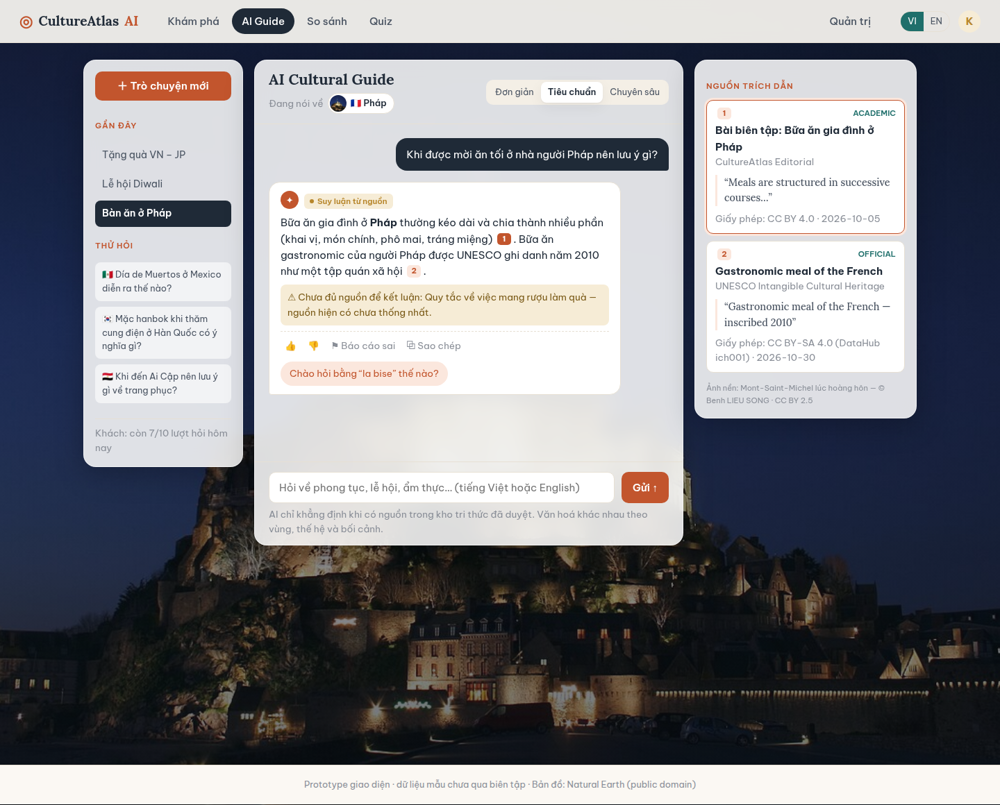 |

#### Culture comparison

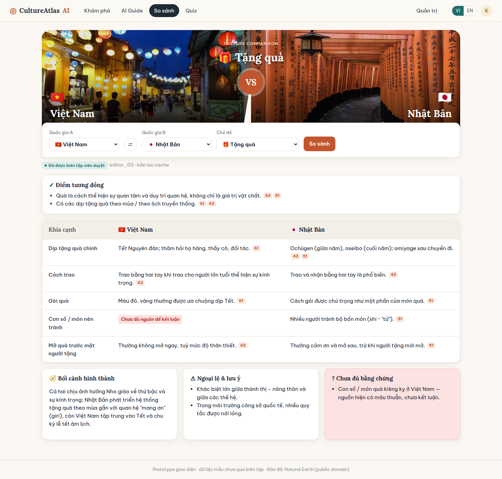

#### Quiz

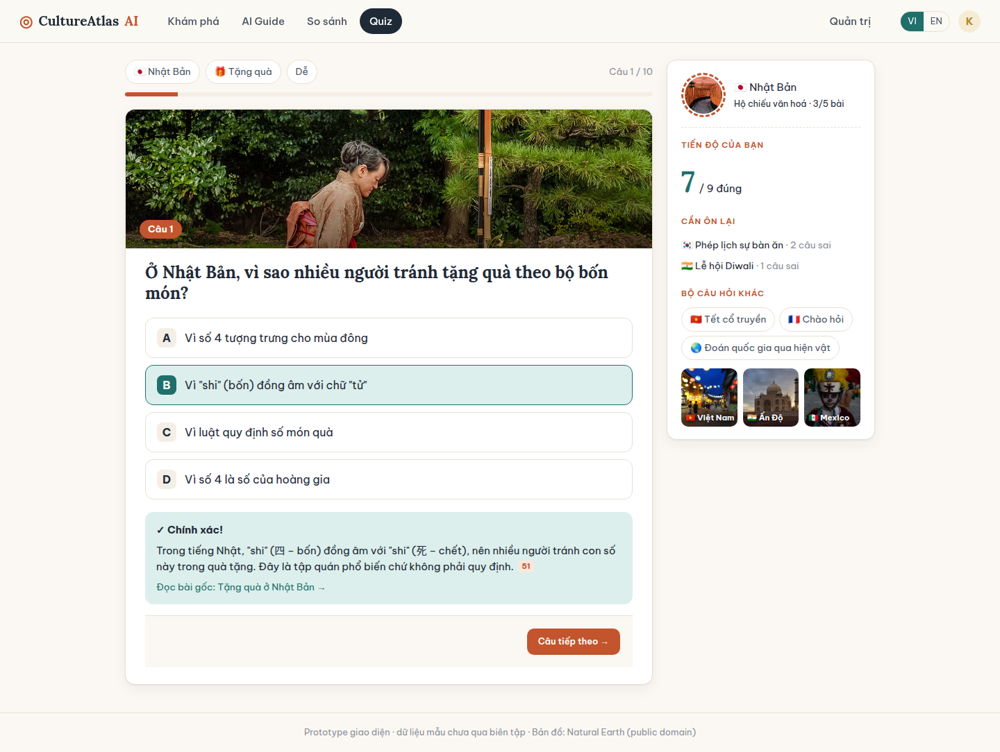

#### Content administration

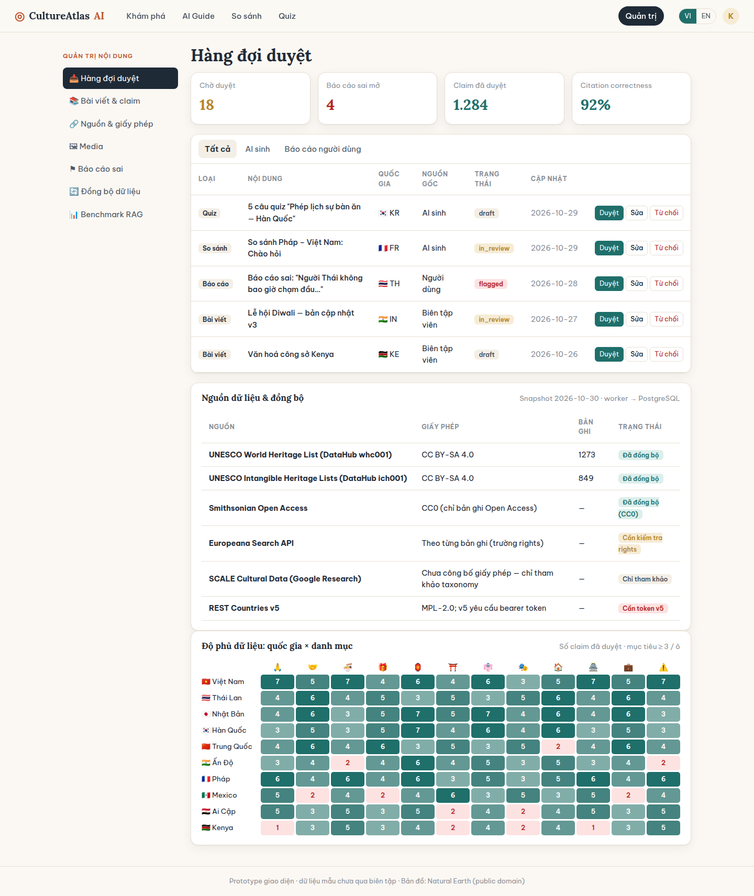

## 3. C4 Architecture

This README presents C1–C3. C4 Level 4 and detailed class and sequence diagrams are in [Section 6](#6-detailed-class-and-sequence-design).

### C1 — System Context

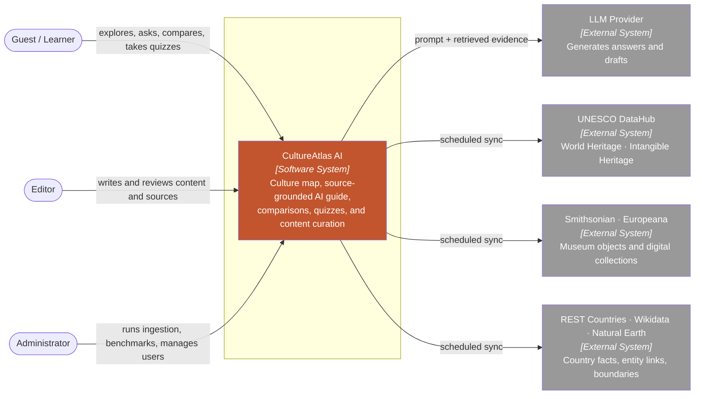

### C2 — Container

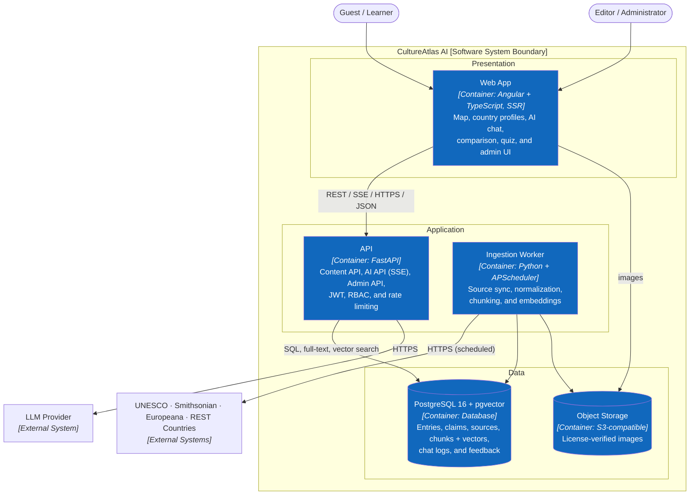

### C3 — Component

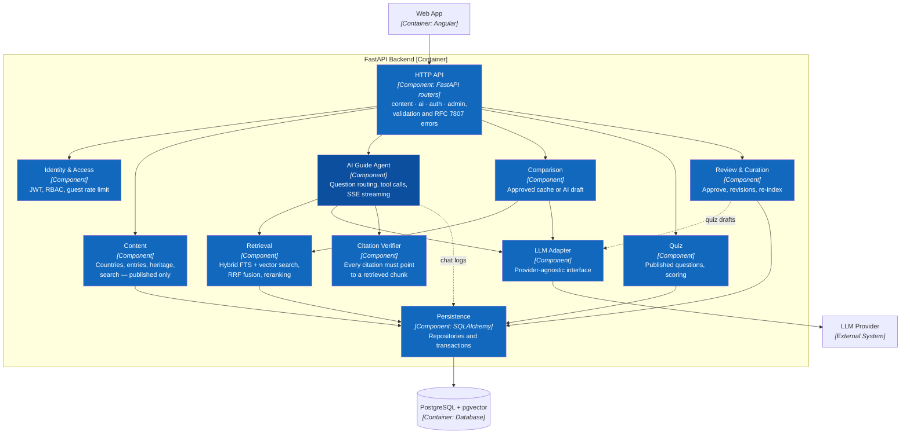

Key architecture decisions: one PostgreSQL instance for relational data, full-text, and vectors; no external API calls in the user request path (all source data flows through the worker into the database); the LLM sits behind an adapter; a single agent with specialized tools instead of a multi-agent setup.

## 4. Database Diagrams and OpenAPI 3.0 Contract

Step 4 defines the persistence contract and the HTTP contract connecting the Angular frontend to the FastAPI backend.

### 4.1 Database diagrams

The target PostgreSQL model stores content as **claims**: small, verifiable statements, each linked to one or more sources with an evidence excerpt, a scope (common practice, historical tradition, regional, community-specific), and a confidence level. Entries are chunked for hybrid retrieval, and every published change is versioned.

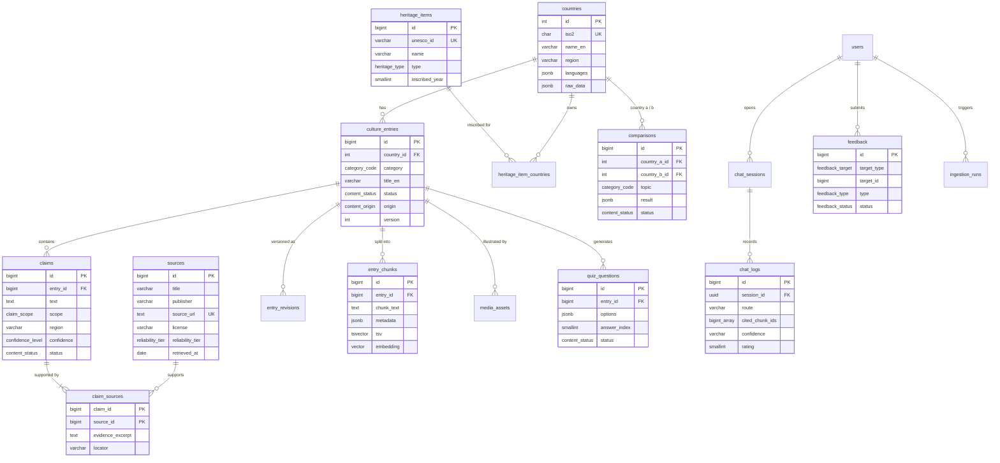

The schema enforces key business rules: a trigger blocks publishing a claim without a source, regional claims must name a region, media files are stored only after license verification, and full-text search uses `unaccent` so unaccented Vietnamese queries still match. The schema has been run against `pgvector/pgvector:pg16`.

See the [detailed database diagram](docs/DATABASE.md), [data model](docs/05-data-model.md), [DBML model](src/database/culture_atlas.dbml), and [PostgreSQL schema](src/database/culture_atlas.sql).

### 4.2 OpenAPI 3.0 API documentation

The HTTP contract is defined with OpenAPI 3.0.4 and organized into Countries, Content, Heritage, Search, Quiz, Feedback, AI, Auth, and Admin (Review, Content, Sources, Feedback, Operations, Users).

```text
31 paths
33 operations
Bearer JWT security (optional for guests, required for admin)
x-roles metadata on every admin operation
Server-Sent Events for streaming AI answers
Reusable request/response schemas, including citations and comparisons
RFC 7807-compatible application/problem+json errors
Request, success, and error examples
```

Every operation has a stable `operationId`, documented parameters, request and response schemas, and success/error status codes. The contract passes Redocly CLI validation and is a design source of truth; the backend runtime has not been implemented yet.

- [OpenAPI 3.0.4 specification](docs/api/openapi.yaml)

## 5. Frontend and Backend Folder Structures

### 5.1 Current repository layout

```text
Culture/
├── src/
│   ├── frontend/                     # Angular 22 prototype (standalone components, zoneless)
│   │   ├── src/app/
│   │   │   ├── core/                 # Models, data service, mock data, real source snapshot
│   │   │   ├── shared/components/    # World map, credited photo, scope/confidence/citation badges
│   │   │   └── features/             # Explorer, country, AI guide, compare, quiz, admin
│   │   ├── public/images/            # Wikimedia Commons photos + credits, Smithsonian objects
│   │   └── package.json
│   ├── backend/                      # FastAPI + ingestion worker skeleton
│   │   ├── app/                      # API, core, schemas, domain, repositories, services, ai
│   │   ├── worker/                   # Source ingestion and RAG pipeline
│   │   ├── eval/                     # RAG benchmark
│   │   └── tests/
│   └── database/
│       ├── culture_atlas.sql         # PostgreSQL + pgvector schema, constraints, trigger, view, seeds
│       └── culture_atlas.dbml        # Database relationship model
├── docs/
│   ├── api/                          # OpenAPI contract
│   ├── requirements/                 # Business rules and non-functional requirements
│   ├── mindmap/                      # Mind map data and renderer
│   ├── images/                       # UI screenshots
│   └── 01-scope.md … 08-invest-requirements.md
├── compose.yaml                      # db (pgvector) · api · worker · web
└── README.md
```

The frontend is a working prototype backed by sample content and real source snapshots; it is not yet connected to the API. The backend contains the target module layout with a runnable health endpoint and test. See [Project Progress](#project-progress) for the current checklist.

### 5.2 Target Angular feature structure

```text
src/frontend/src/app/
├── app.component.ts     # Application shell, navigation, language switch
├── app.config.ts        # Providers, router, HTTP client
├── app.routes.ts        # Lazy-loaded feature routes
├── core/
│   ├── models/          # Types mirroring the OpenAPI schemas
│   ├── services/        # API client, auth, SSE chat stream
│   └── interceptors/    # JWT and RFC 7807 error handling
├── shared/
│   └── components/      # Map, photo with attribution, badges, citation chips, states
├── features/
│   ├── explorer/
│   ├── country/
│   ├── entry/
│   ├── heritage/
│   ├── ai-guide/
│   ├── compare/
│   ├── quiz/
│   ├── auth/
│   └── admin/           # review, entries, sources, media, feedback, coverage, ingestion, users
└── styles/              # Design tokens
```

Target dependency flow:

```text
Page/Component → Feature Service → core API client → REST / SSE API
```

### 5.3 Target FastAPI layered structure

```text
src/backend/
├── app/
│   ├── api/             # Presentation: routers for content, ai, auth, admin
│   ├── core/            # Config, database, security (JWT/RBAC), errors, rate limiting
│   ├── schemas/         # Pydantic request/response models matching OpenAPI
│   ├── domain/          # ORM models, enums, business policies
│   ├── repositories/    # SQL, full-text, and vector queries
│   ├── services/        # Content, comparison, quiz, review use cases
│   └── ai/              # Router, agent, tools, retrieval, reranker, LLM adapter, citation verifier, prompts
├── worker/
│   ├── ingest/          # UNESCO, REST Countries, Smithsonian, Europeana, Wikidata
│   └── pipeline/        # Normalize, chunk, embed
├── eval/                # RAG benchmark questions and runner (CI)
└── tests/
```

Dependency rules:

```text
api → services → repositories → database
api → ai.agent → ai.tools → retrieval → repositories
ai.agent → llm_adapter (interface only)
domain → neither api nor repositories
worker → domain + repositories, never api
```

## 6. Detailed Class and Sequence Design

Detailed design derives from the C4 components in Section 3, the database and OpenAPI contracts in Section 4, and the target folder ownership in Section 5. These diagrams are target design views.

### 6.1 C4 Level 4 — Code collaboration

#### L4.1 AI Cultural Guide

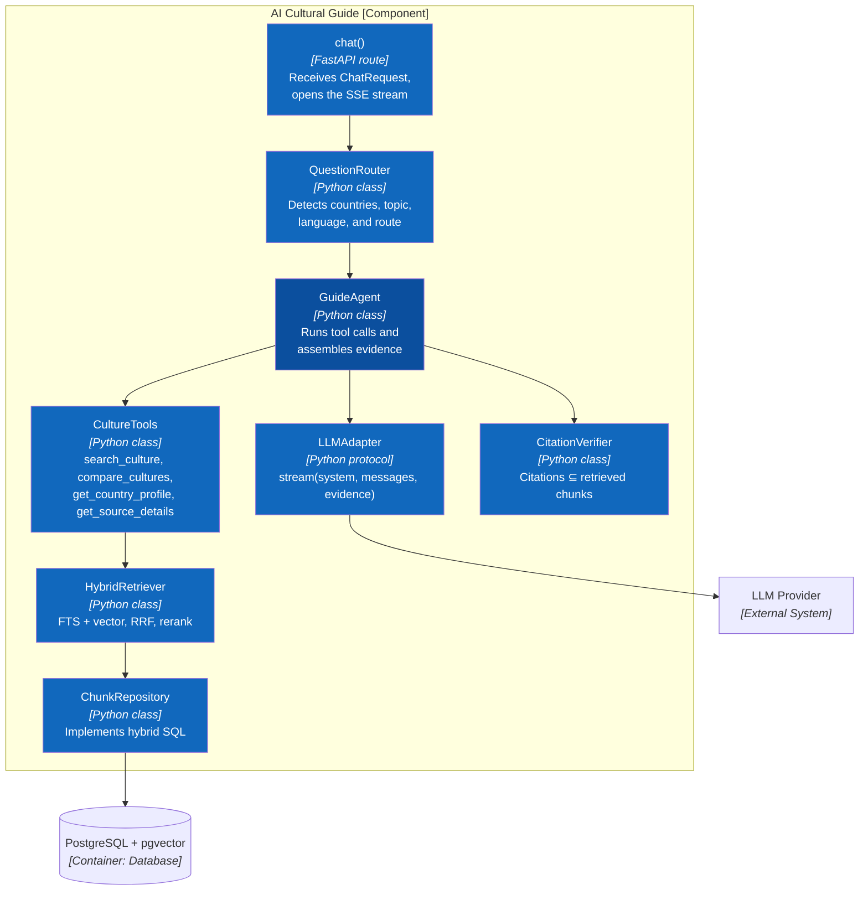

#### L4.2 Content Review

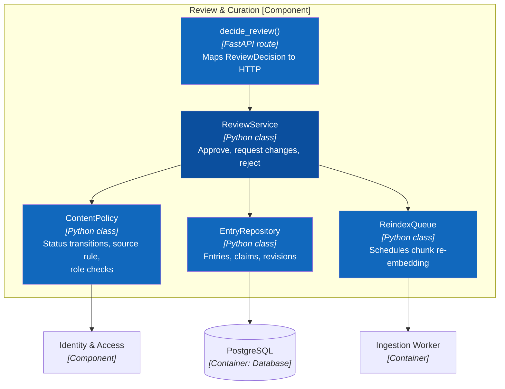

### 6.2 Core class diagrams

#### 1. AI Cultural Guide

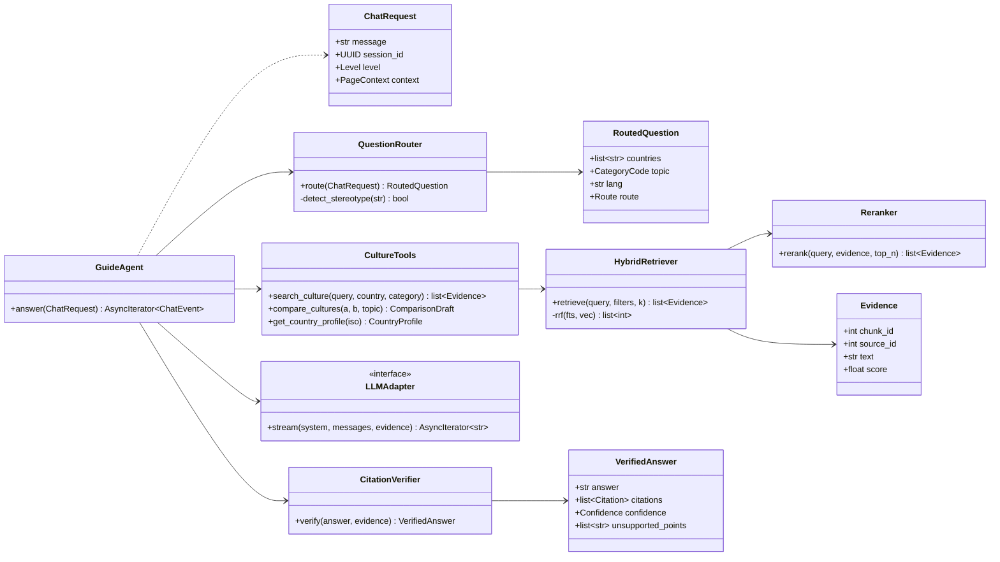

#### 2. Content and Claims

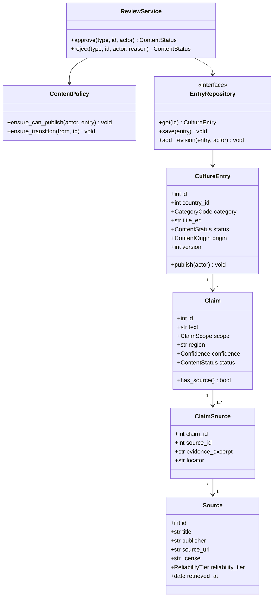

### 6.3 Sequence diagrams

Runtime sequences cover asking the AI Guide with citations, comparing cultures, and reviewing AI-generated content. Each sequence maps the user story and OpenAPI operation to its route, service, policy, repository, database interaction, success response, and error paths.

#### Ask the AI Cultural Guide (US06–US08, `POST /ai/chat`)

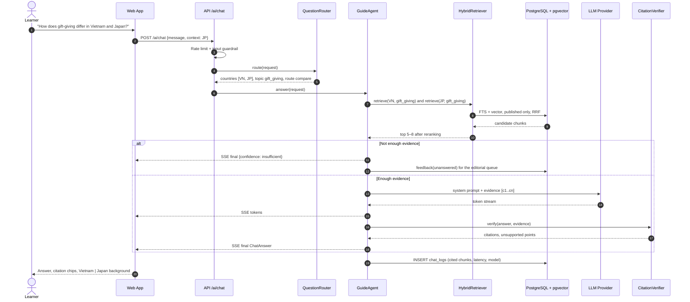

#### Review AI-generated content (US16, `POST /admin/review/{targetType}/{id}/decision`)

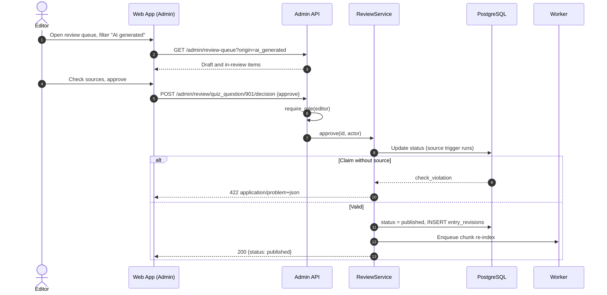

## Documentation

- Requirements: [Scope](docs/01-scope.md), [Features](docs/02-features.md), [INVEST backlog](docs/08-invest-requirements.md), [Acceptance criteria](docs/06-acceptance-criteria.md).
- Requirements catalogs: [Business rules](docs/requirements/business-rules.md) and [Non-functional requirements](docs/requirements/non-functional-requirements.md).
- UI/UX: [Information architecture](docs/04-information-architecture.md), [Angular prototype](src/frontend).
- Mind map: [PNG](docs/mindmap.png) and [XMind](docs/mindmap.xmind).
- Database: [Data model](docs/05-data-model.md), [ER diagram](docs/DATABASE.md), [DBML](src/database/culture_atlas.dbml), [PostgreSQL schema](src/database/culture_atlas.sql).
- API contract: [OpenAPI 3.0.4 specification](docs/api/openapi.yaml).

## Project Progress

- [x] Define scope, goals, personas, and user roles
- [x] Write the feature list and use cases
- [x] Write user stories following INVEST
- [x] Write acceptance criteria and business rules
- [x] Write non-functional requirements
- [x] Survey open data sources and capture real snapshots (UNESCO, Smithsonian, Europeana, SCALE)
- [x] Design the information architecture and screen permissions
- [x] Design the screen hierarchy, task flows, and UI states
- [x] Build the Angular UI prototype for the main screens
- [x] Add country-themed backgrounds to the AI Guide
- [x] Design the C4 System Context
- [x] Design the C4 Container
- [x] Design the C4 Component and Code levels
- [x] Design the PostgreSQL + pgvector schema, DBML, and data relationships
- [x] Write the API documentation in OpenAPI 3.0
- [x] Design the Angular frontend folder structure
- [x] Design the FastAPI backend and worker folder structure
- [x] Design class diagrams and sequence diagrams
- [ ] Connect the Angular frontend to the API
- [ ] Implement ingestion for UNESCO, REST Countries, Smithsonian, and Europeana
- [ ] Implement the RAG pipeline (chunking, embeddings, hybrid search, reranking, citation verification)
- [ ] Write source-backed etiquette content for 10 countries × 12 categories
- [ ] Build the 100–150 question RAG benchmark and run it in CI
- [ ] Add Angular SSR, authentication, RBAC, and rate limiting
