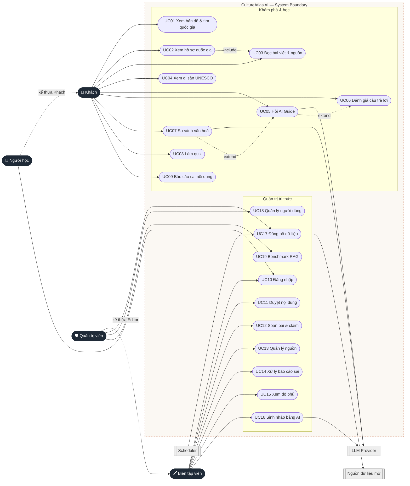

# 03 — Tác nhân, vai trò và Use case

## 1. Tác nhân (Actors)

| Tác nhân | Loại | Mô tả |
|---|---|---|
| **Khách (Guest)** | Chính | Người dùng chưa đăng nhập: khám phá, hỏi AI (giới hạn lượt), so sánh, làm quiz |
| **Người học (Learner)** | Chính | Người dùng có tài khoản: như Khách + không giới hạn chặt, lưu tiến độ *(đầy đủ ở giai đoạn 4)* |
| **Biên tập viên (Editor)** | Chính | Soạn, duyệt nội dung; quản lý nguồn; xử lý báo cáo sai |
| **Quản trị viên (Admin)** | Chính | Như Editor + quản lý người dùng, đồng bộ dữ liệu, benchmark |
| LLM Provider | Phụ (hệ thống ngoài) | Sinh câu trả lời / nháp nội dung qua adapter |
| Nguồn dữ liệu mở | Phụ (hệ thống ngoài) | REST Countries, UNESCO DataHub, Natural Earth, Wikidata… |
| Bộ lập lịch (Scheduler) | Phụ | Kích hoạt worker đồng bộ định kỳ |

## 2. Danh sách Use case

| ID | Use case | Tác nhân | MVP |
|---|---|---|---|
| UC01 | Xem bản đồ & tìm quốc gia | Khách, Người học | ✅ |
| UC02 | Xem hồ sơ quốc gia | Khách, Người học | ✅ |
| UC03 | Đọc bài viết, claim và nguồn | Khách, Người học | ✅ |
| UC04 | Xem di sản UNESCO | Khách, Người học | ✅ |
| UC05 | Hỏi AI Cultural Guide | Khách, Người học, *LLM* | ✅ |
| UC06 | Đánh giá / báo cáo câu trả lời AI | Khách, Người học | ✅ |
| UC07 | So sánh văn hoá hai quốc gia | Khách, Người học, *LLM* | ✅ |
| UC08 | Làm quiz và xem giải thích | Khách, Người học | ✅ |
| UC09 | Báo cáo sai nội dung | Khách, Người học | ✅ |
| UC10 | Đăng nhập / đăng xuất | Người học, Editor, Admin | ✅ |
| UC11 | Duyệt nội dung (bài, claim, quiz, so sánh) | Editor, Admin | ✅ |
| UC12 | Soạn / sửa bài viết và claim | Editor, Admin | ✅ |
| UC13 | Quản lý nguồn và giấy phép | Editor, Admin | ✅ |
| UC14 | Xử lý báo cáo sai | Editor, Admin | ✅ |
| UC15 | Xem bảng độ phủ dữ liệu | Editor, Admin | ✅ |
| UC16 | Sinh nháp quiz / so sánh bằng AI | Editor, Admin, *LLM* | ✅ |
| UC17 | Kích hoạt & theo dõi đồng bộ dữ liệu | Admin, *Scheduler*, *Nguồn mở* | ✅ |
| UC18 | Quản lý người dùng & phân quyền | Admin | ✅ |
| UC19 | Xem kết quả benchmark RAG | Admin | ✅ |
| UC20 | Học qua tình huống (Scenario) | Người học | ⏭ |
| UC21 | Hộ chiếu văn hoá & gợi ý lộ trình | Người học | ⏭ |

## 3. Sơ đồ Use case

## 4. Ma trận phân quyền

| Năng lực | Khách | Người học | Editor | Admin |
|---|---|---|---|---|
| Xem bản đồ, hồ sơ, bài viết, di sản | ✅ | ✅ | ✅ | ✅ |
| Hỏi AI Guide | ✅ (10 lượt/ngày) | ✅ (giới hạn cao hơn) | ✅ | ✅ |
| So sánh, quiz | ✅ | ✅ | ✅ | ✅ |
| Báo cáo sai, 👍/👎 | ✅ | ✅ | ✅ | ✅ |
| Lưu tiến độ / Passport | — | ✅ *(GĐ4)* | — | — |
| Xem nội dung `draft`, `in_review` | — | — | ✅ | ✅ |
| Soạn / duyệt / xuất bản nội dung | — | — | ✅ | ✅ |
| Quản lý nguồn, media, feedback | — | — | ✅ | ✅ |
| Sinh nháp bằng AI | — | — | ✅ | ✅ |
| Đồng bộ dữ liệu, benchmark | — | — | — | ✅ |
| Quản lý người dùng & vai trò | — | — | — | ✅ |

Backend **bắt buộc** kiểm tra quyền (RBAC); ẩn nút trên giao diện chỉ phục vụ UX.

## 5. Đặc tả Use case chính

### UC05 — Hỏi AI Cultural Guide

| Mục | Nội dung |
|---|---|
| Tác nhân | Khách / Người học; hệ thống ngoài: LLM Provider |
| Tiền điều kiện | Còn lượt hỏi trong ngày; kho tri thức có nội dung `published` |
| Kích hoạt | Người dùng gửi câu hỏi tại trang AI Guide hoặc panel “Hỏi AI” trên trang quốc gia |
| Luồng chính | 1. Người dùng nhập câu hỏi (vi/en). 2. Hệ thống phân tích: quốc gia, chủ đề, ngôn ngữ, loại câu hỏi. 3. Nếu là dữ kiện có cấu trúc → trả lời từ DB (bước 7). 4. Agent gọi tool `search_culture` / `compare_cultures`. 5. Hybrid search (FTS + vector) lọc `published` → rerank top 5–8. 6. LLM tổng hợp chỉ từ bằng chứng, gắn `[c#]`. 7. Kiểm tra trích dẫn: mỗi ý trỏ tới chunk đã truy xuất. 8. Stream câu trả lời + citations + confidence + follow-ups. 9. Lưu `chat_logs`. |
| Luồng thay thế | A1 — Không đủ bằng chứng: trả lời “Kho dữ liệu hiện chưa có đủ nguồn về…”, gợi ý nguồn ngoài, ghi câu hỏi vào hàng đợi biên tập. A2 — Câu hỏi khuôn mẫu (“người nước X đều…”): trả lời theo hướng điều chỉnh nhận thức, có nguồn. A3 — Hết lượt: thông báo, mời đăng nhập. |
| Ngoại lệ | LLM lỗi/timeout → thông báo thử lại, không trả nội dung chưa kiểm chứng |
| Hậu điều kiện | Câu trả lời hiển thị kèm nguồn; log được lưu |

### UC07 — So sánh văn hoá

| Mục | Nội dung |
|---|---|
| Luồng chính | 1. Chọn quốc gia A, B và chủ đề. 2. Hệ thống tìm `comparisons` đã duyệt cho (A, B, topic) — có thì trả ngay. 3. Không có: truy xuất bằng chứng **riêng cho từng quốc gia**, LLM lập bảng, ô thiếu bằng chứng = “chưa đủ nguồn”. 4. Kết quả sinh mới được gắn nhãn “chưa duyệt” và lưu `draft` vào hàng đợi. |
| Hậu điều kiện | Bảng so sánh có nguồn từng ô |

### UC11 — Duyệt nội dung

| Mục | Nội dung |
|---|---|
| Tác nhân | Editor, Admin |
| Luồng chính | 1. Mở hàng đợi, lọc theo loại / nguồn gốc. 2. Mở mục, đối chiếu claim với nguồn. 3. Chọn Duyệt (→ `published`, tạo revision, re-index chunks), Sửa, hoặc Từ chối (→ `archived`, có lý do). |
| Quy tắc | Nội dung AI sinh luôn bắt đầu `draft`; chỉ `published` được dùng cho RAG |

### UC09/UC14 — Báo cáo sai và xử lý

Người dùng gửi báo cáo (loại lỗi + mô tả) → nội dung chuyển `flagged` nếu vượt ngưỡng hoặc Editor xác nhận → Editor sửa và duyệt lại (`in_review` → `published`) hoặc đóng báo cáo.

### UC17 — Đồng bộ dữ liệu

Scheduler/Admin kích hoạt → worker gọi API nguồn → lưu `raw_data` + giấy phép → chuẩn hoá ISO 3166 → upsert → chunk + embedding → ghi `ingestion_runs` (records_in, records_changed, errors).
