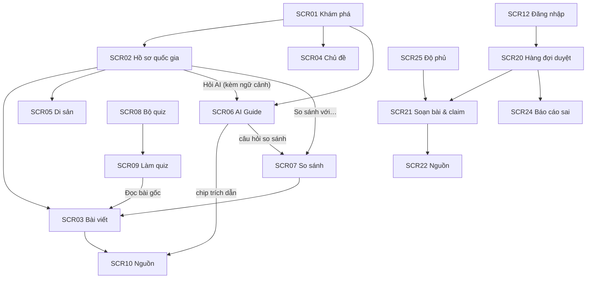

# 04 — Kiến trúc thông tin và UI/UX

## 1. Nguyên tắc tổ chức thông tin

1. **Quốc gia là trục chính, chủ đề là trục phụ.** Mọi nội dung có toạ độ (quốc gia × danh mục) → điều hướng, so sánh và đo độ phủ dùng chung một lưới.
2. **Nguồn luôn trong tầm một cú nhấp.** Mọi claim / câu trả lời có chip nguồn; không có trang nào “nói” mà không cho xem nguồn.
3. **AI là lớp phủ, không phải ngõ cụt.** Từ bất kỳ trang nội dung nào cũng hỏi được AI, và từ câu trả lời AI luôn quay về được bài gốc.
4. **Tách khu vực công khai và khu vực biên tập.** Người học không bao giờ thấy nội dung `draft`.

## 2. Sitemap

```text
Công khai (Khách / Người học)
├── / ......................................... SCR01 Khám phá (bản đồ, tìm kiếm, chủ đề, lễ hội tháng này)
├── /countries/:iso ............................ SCR02 Hồ sơ quốc gia
│   ├── ?category=:code ........................ (lọc danh mục)
│   └── /entries/:id ........................... SCR03 Chi tiết bài viết + claim + nguồn
├── /themes/:slug .............................. SCR04 Chủ đề xuyên quốc gia
├── /heritage?country=&type= ................... SCR05 Di sản UNESCO
├── /guide ..................................... SCR06 AI Cultural Guide
├── /compare?a=&b=&topic= ...................... SCR07 So sánh văn hoá
├── /quiz ...................................... SCR08 Chọn bộ quiz
│   └── /quiz/:setId ........................... SCR09 Làm quiz + giải thích + tổng kết
├── /sources/:id ............................... SCR10 Chi tiết nguồn & giấy phép
├── /about/methodology ......................... SCR11 Phương pháp & nguyên tắc biên tập
└── /login ..................................... SCR12 Đăng nhập

Quản trị (Editor / Admin)
└── /admin
    ├── /review ................................ SCR20 Hàng đợi duyệt
    ├── /entries, /entries/:id/edit ............ SCR21 Bài viết & claim (soạn, tách claim, gắn nguồn)
    ├── /sources ............................... SCR22 Nguồn & giấy phép
    ├── /media ................................. SCR23 Media & ghi công
    ├── /feedback .............................. SCR24 Báo cáo sai
    ├── /coverage .............................. SCR25 Độ phủ quốc gia × danh mục
    ├── /ingestion ............................. SCR26 Đồng bộ dữ liệu        (Admin)
    ├── /benchmark ............................. SCR27 Benchmark RAG          (Admin)
    └── /users ................................. SCR28 Người dùng & vai trò   (Admin)

Hệ thống: /403 Không có quyền · /404 Không tìm thấy
```

## 3. Phân cấp màn hình và điều hướng



**Thanh điều hướng chính:** Khám phá · AI Guide · So sánh · Quiz · (Quản trị — chỉ khi có vai trò) · chuyển ngôn ngữ VI/EN · tài khoản.

## 4. Luồng nhiệm vụ chính (Task flows)

| Flow | Bước | Màn hình |
|---|---|---|
| TF1 — Chuẩn bị đi Nhật (persona P1) | Bản đồ → chọn Nhật Bản → đọc “5 điều cần biết” → Hỏi AI về tặng quà → So sánh với Việt Nam → Quiz 2 phút | 01 → 02 → 06 → 07 → 09 |
| TF2 — Kiểm chứng một phát biểu | Đọc claim → bấm chip nguồn → xem đoạn trích + giấy phép → mở nguồn gốc | 03 → 10 |
| TF3 — Báo cáo sai | Bấm “⚑ Báo cáo sai” → chọn loại → gửi → cảm ơn | 03/06 → modal |
| TF4 — Duyệt quiz do AI sinh | Hàng đợi → lọc “AI sinh” → mở mục → đối chiếu nguồn → Duyệt/Sửa/Từ chối | 20 → 21 |
| TF5 — Lấp chỗ trống dữ liệu | Độ phủ → bấm ô đỏ → soạn bài mới → tách claim → gắn nguồn → gửi duyệt | 25 → 21 → 22 |

## 5. Trạng thái màn hình (UI states)

| Trạng thái | Cách hiển thị |
|---|---|
| Đang tải | Skeleton theo bố cục thật (thẻ, bảng); chat dùng con trỏ nhấp nháy khi streaming |
| Rỗng | Câu giải thích + hành động tiếp theo (“Chưa có bài đã duyệt — hỏi AI?”) |
| Thiếu nguồn | Nhãn đỏ nhạt “Chưa đủ nguồn để kết luận” — **là trạng thái hợp lệ, không phải lỗi** |
| Chưa duyệt | Nhãn vàng “Chưa được biên tập viên duyệt” trên nội dung sinh mới |
| Lỗi | Thông báo ngắn + nút thử lại; không hiển thị nội dung AI chưa kiểm chứng |
| Hết lượt hỏi | Banner mời đăng nhập, đếm ngược tới ngày mới |
| Không có quyền | Trang 403 với liên kết quay lại |

## 6. Hệ thống thiết kế (UI/UX)

### 6.1 Định hướng thị giác
“**Atlas biên tập**” — cảm giác như một cuốn sách địa lý/văn hoá hiện đại: nền giấy ấm, tiêu đề serif, nội dung sans-serif dễ đọc tiếng Việt, màu nhấn đất nung (văn hoá, con người) và xanh mòng két (tri thức đã kiểm chứng).

### 6.2 Design tokens

| Token | Giá trị | Dùng cho |
|---|---|---|
| `--paper` | `#FBF8F3` | Nền trang |
| `--surface` | `#FFFFFF` | Thẻ, bảng |
| `--ink` | `#1F2A37` | Chữ chính, nav active |
| `--accent` | `#C2552D` | CTA, chip trích dẫn, điểm nhấn |
| `--teal` | `#1F6F6B` | Trạng thái “đã kiểm chứng”, độ phủ cao |
| `--gold` | `#B7862B` | “Hỗ trợ một phần”, chờ duyệt |
| `--red` | `#B42318` | “Chưa đủ nguồn”, báo cáo sai |
| Font tiêu đề | Lora 600–700 | H1–H3 |
| Font nội dung | Be Vietnam Pro 400–700 | Toàn bộ văn bản, hỗ trợ dấu tiếng Việt tốt |
| Bo góc | 14 px thẻ · 10 px nút · 999 px chip | |

### 6.3 Thành phần giao diện chính

| Thành phần | Mô tả |
|---|---|
| `ca-world-map` | Bản đồ SVG/MapLibre, tô theo độ phủ, ghim cờ cho quốc gia nổi bật |
| `ca-cite` | Chip số nguồn; hover hiện nhà xuất bản + giấy phép |
| `ca-scope-badge` | Nhãn phạm vi claim |
| `ca-confidence-badge` | Nhãn độ chắc chắn (xanh / vàng / đỏ) |
| Thẻ “5 điều cần biết” | Nền vàng nhạt, danh sách đánh số, mỗi dòng một nguồn |
| Bong bóng chat AI | Biểu tượng ✦, nhãn confidence, đoạn văn có chip `[c#]`, hộp “chưa đủ nguồn”, hành động 👍 👎 ⚑, gợi ý tiếp |
| Bảng so sánh | Cột khía cạnh cố định, ô thiếu nguồn = nhãn đỏ |
| Ô heatmap độ phủ | Xanh đậm dần theo số claim; < 3 = đỏ nhạt |

### 6.4 Khả năng truy cập
Tương phản ≥ 4.5:1 cho văn bản; màu không là kênh duy nhất (luôn có chữ trên nhãn); bản đồ có danh sách quốc gia thay thế; mọi nút có nhãn văn bản; hỗ trợ `prefers-reduced-motion`.

## 7. Màn hình chính đã dựng (prototype Angular)

Prototype nằm ở [src/frontend](../src/frontend), chạy bằng `npm start`. Nội dung phong tục là dữ liệu mẫu (`mock-data.ts`); di sản UNESCO, hiện vật Smithsonian/Europeana, gợi ý SCALE là dữ liệu thật (`sources-snapshot.json`); ảnh từ Wikimedia Commons có ghi công (`public/images/culture/credits.json`).

| Màn hình | Route | Ảnh |
|---|---|---|
| SCR01 Khám phá | `/` | [01-explorer.png](images/01-explorer.png) |
| SCR02 Hồ sơ quốc gia | `/countries/JP` | [02-country-profile.png](images/02-country-profile.png) |
| SCR06 AI Cultural Guide (nền chia đôi VN–JP) | `/guide` | [03-ai-guide.png](images/03-ai-guide.png) |
| SCR06 — nền Ấn Độ / Pháp | `/guide?session=1`, `?session=2` | [07](images/07-ai-guide-india.png), [08](images/08-ai-guide-france.png) |
| SCR07 So sánh văn hoá | `/compare` | [04-compare.png](images/04-compare.png) |
| SCR09 Làm quiz | `/quiz` | [05-quiz.png](images/05-quiz.png) |
| SCR20 + SCR25 Quản trị | `/admin` | [06-admin.png](images/06-admin.png) |

## 8. Ánh xạ màn hình ↔ API

| Màn hình | API |
|---|---|
| SCR01 | `GET /api/countries`, `GET /api/search`, `GET /api/themes`, `GET /api/festivals?month=` |
| SCR02 | `GET /api/countries/{iso}`, `GET /api/countries/{iso}/entries`, `GET /api/heritage?country=` |
| SCR03 | `GET /api/entries/{id}`, `POST /api/feedback` |
| SCR06 | `POST /api/ai/chat` (SSE), `POST /api/ai/chat/{messageId}/rating` |
| SCR07 | `POST /api/ai/compare` |
| SCR08–09 | `GET /api/quizzes`, `POST /api/quizzes/{id}/attempts` |
| SCR10 | `GET /api/sources/{id}` |
| SCR12 | `POST /api/auth/login` |
| SCR20 | `GET /api/admin/review-queue`, `POST /api/admin/review/{type}/{id}/decision` |
| SCR21 | `POST/PUT /api/admin/entries`, `POST /api/admin/entries/{id}/claims` |
| SCR22 | `GET/POST/PUT /api/admin/sources` |
| SCR24 | `GET /api/admin/feedback`, `PATCH /api/admin/feedback/{id}` |
| SCR25 | `GET /api/admin/coverage` |
| SCR26 | `POST /api/admin/ingestion/runs`, `GET /api/admin/ingestion/runs` |
