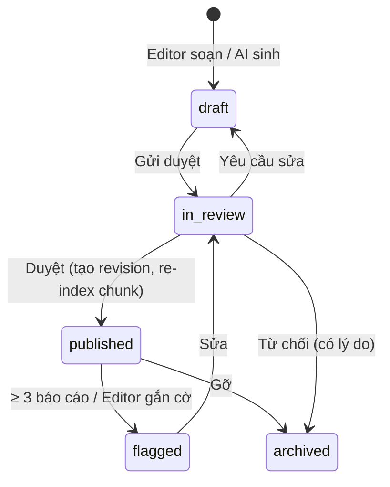

# 05 — Mô hình dữ liệu

> Bước 5 · DBML: [culture_atlas.dbml](../src/database/culture_atlas.dbml) · SQL: [culture_atlas.sql](../src/database/culture_atlas.sql) · ER Mermaid: [DATABASE.md](DATABASE.md)
> Đã kiểm tra: schema chạy sạch trên `pgvector/pgvector:pg16`; tìm “nhat ban” khớp “Nhật Bản” nhờ cấu hình `ca_simple` + `unaccent`.

## 1. Nhóm bảng

| Nhóm | Bảng | Vai trò |
|---|---|---|
| Danh mục nền | `countries`, `tags`, `entry_tags` | Quốc gia (ISO 3166), thẻ chủ đề xuyên quốc gia |
| Nội dung có nguồn | `culture_entries`, `claims`, `claim_sources`, `sources`, `entry_revisions` | Bài viết → claim → nguồn + đoạn bằng chứng; lịch sử phiên bản |
| Di sản & media | `heritage_items`, `heritage_item_countries`, `media_assets` | Dữ liệu UNESCO (di sản đa quốc gia), hình ảnh có giấy phép |
| RAG | `entry_chunks` | Đoạn văn + `tsvector` + `vector(1024)` |
| Học tập | `comparisons`, `quiz_questions`, `user_progress` | So sánh đã duyệt / cache, quiz, tiến độ |
| AI & phản hồi | `chat_sessions`, `chat_logs`, `feedback` | Lịch sử hỏi đáp, đánh giá, báo cáo sai |
| Vận hành | `users`, `ingestion_runs` | Tài khoản & vai trò, nhật ký đồng bộ |

## 2. Từ điển dữ liệu — bảng chính

### `claims`
| Cột | Kiểu | Ràng buộc | Ý nghĩa |
|---|---|---|---|
| `id` | bigserial | PK | |
| `entry_id` | bigint | FK → culture_entries, cascade | Bài viết chứa claim |
| `text` | text | not null | Phát biểu kiểm chứng được |
| `scope` | `claim_scope` | not null | Phổ biến / lịch sử / vùng miền / cộng đồng |
| `region` | varchar | bắt buộc khi `scope = regional` (CHECK) | |
| `confidence` | `confidence_level` | default `unverified` | |
| `status` | `content_status` | default `draft`; trigger cấm `published` khi chưa có nguồn | BR01 |

### `sources`
| Cột | Ý nghĩa |
|---|---|
| `license` | Bắt buộc. Ví dụ `CC BY-SA 4.0`, `CC0`, `Trích dẫn ngắn – liên kết nguồn` |
| `reliability_tier` | `official` > `museum` ≈ `academic` > `community` — dùng làm trọng số khi rerank |
| `retrieved_at` | Ngày truy xuất, hiển thị cùng trích dẫn |
| `source_url` | Duy nhất — khoá khử trùng khi ingest |

### `entry_chunks`
| Cột | Ý nghĩa |
|---|---|
| `chunk_text` | 300–500 token, chồng lấn 10–15%, cắt theo ranh giới claim |
| `claim_ids` | Các claim nằm trong chunk → truy ngược nguồn khi trích dẫn |
| `metadata` | `{country, category, scope, language, source_ids, status}` để lọc trước khi tìm |
| `tsv` | Cột sinh tự động `to_tsvector('ca_simple', chunk_text)` — GIN |
| `embedding` | `vector(1024)` (BGE-M3 / multilingual-E5 large) — HNSW cosine |

### `comparisons.result` (JSONB)
```json
{
  "similarities": [{ "text": "…", "source_ids": [62, 51] }],
  "rows": [
    { "aspect": "Cách trao", "a": { "text": "…", "source_ids": [62] }, "b": { "text": "…", "source_ids": [42] } },
    { "aspect": "Con số nên tránh", "a": null, "b": { "text": "…", "source_ids": [51] } }
  ],
  "context": "…",
  "caveats": ["…"],
  "insufficient": ["…"]
}
```
`a`/`b = null` ⇒ giao diện hiển thị “Chưa đủ nguồn để kết luận” (BR07).

## 3. Enum

| Enum | Giá trị |
|---|---|
| `content_status` | draft, in_review, published, flagged, archived |
| `category_code` | greetings, etiquette, food_dining, gift_giving, festivals, religion_beliefs, clothing, arts_music, family_life, heritage, business_culture, taboos |
| `claim_scope` | common_practice, historical_tradition, regional, community_specific |
| `confidence_level` | verified, partially_supported, unverified |
| `user_role` | learner, editor, admin |
| `feedback_type` | factual_error, stereotype, missing_source, unanswered, other |

## 4. Chỉ mục và ràng buộc quan trọng

| Đối tượng | Mục đích |
|---|---|
| `ix_chunks_embedding` HNSW cosine | Tìm ngữ nghĩa |
| `ix_chunks_tsv` GIN | Full-text (BM25-like `ts_rank_cd`) |
| `ix_chunks_metadata` GIN `jsonb_path_ops` | Lọc quốc gia / danh mục trước khi xếp hạng |
| `ix_entries_country_cat_status` | Trang hồ sơ quốc gia theo danh mục |
| `ck_claim_region` | BR05 |
| `trg_claim_requires_source` | BR01 — không xuất bản claim thiếu nguồn |
| `ck_media_stored_only_if_verified` | BR09 |
| `ck_cmp_distinct` + unique `(a, b, topic, language)` | Một bản so sánh đã duyệt cho mỗi cặp |
| `v_coverage` | Bảng độ phủ SCR25 |

## 5. Truy vấn hybrid search (tham khảo)

```sql
WITH q AS (SELECT plainto_tsquery('ca_simple', :query) AS tsq, :embedding::vector AS emb),
fts AS (
  SELECT id, row_number() OVER (ORDER BY ts_rank_cd(tsv, q.tsq) DESC) AS r
  FROM entry_chunks, q
  WHERE tsv @@ q.tsq AND metadata @> :filter::jsonb
  LIMIT 40
),
vec AS (
  SELECT id, row_number() OVER (ORDER BY embedding <=> q.emb) AS r
  FROM entry_chunks, q
  WHERE metadata @> :filter::jsonb
  ORDER BY embedding <=> q.emb
  LIMIT 40
)
SELECT id, SUM(1.0 / (60 + r)) AS rrf          -- Reciprocal Rank Fusion, k = 60
FROM (SELECT * FROM fts UNION ALL SELECT * FROM vec) u
GROUP BY id ORDER BY rrf DESC LIMIT 20;         -- → cross-encoder rerank → top 5–8
```

`:filter` luôn chứa `{"status": "published"}` (BR02).

## 6. Vòng đời dữ liệu


