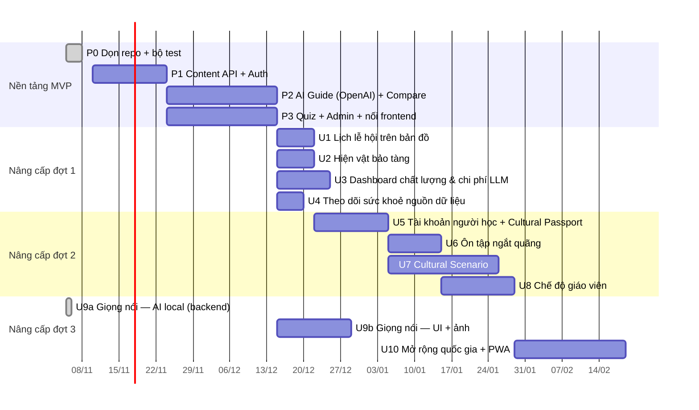

# 10 — Kế hoạch triển khai và tính năng nâng cấp

> Lập ngày 05/11/2026. Giả định nhóm 2–3 người, sprint 2 tuần.
> Nguyên tắc: **mỗi tính năng có AC trước, có test trước khi merge** ([tests/README](../src/backend/tests/README.md)).
> Các AC đề xuất ở đây (AC-U1.x trở đi) chỉ được chuyển vào [06-acceptance-criteria.md](06-acceptance-criteria.md) khi tính năng bắt đầu được làm. Khi đó, test truy vết sẽ bắt buộc phải có test tương ứng.

## Tổng quan lộ trình

## Giai đoạn 0–3: hoàn thành MVP (điều kiện tiên quyết)

Mọi tính năng nâng cấp đều cần backend thật. Thước đo tiến độ: **số test PENDING giảm về 0**. Hiện tại backend còn 74 test PENDING và frontend còn 15.

| Giai đoạn | Việc chính | Test sẽ tự bật | Ước lượng |
|---|---|---|---|
| **P0** ✅ | Bộ test, CI, git hook, DB test; sửa lỗi đóng gói `pyproject.toml` | — | xong |
| **P0** (tiếp) ✅ | Commit worker; dọn link tới `CultureAtlas-AI.md` (file đã bị xoá) | — | xong |
| **P1** | `core/` (config, DB async, lỗi RFC 7807 với validate = 400), ORM, repositories. Content API: countries, entries, heritage, search, sources, themes, festivals, feedback. Auth JWT + RBAC | `test_f1_explorer.py`, phần auth của `test_f7_admin.py` | 2 tuần |
| **P2** | Core AI GPT-6 Luna + dự phòng GPT-4o (`OpenAIAdapter` ✅ đã có), embedding và rerank qua dịch vụ AI local ✅, hybrid retrieval, router, agent stream SSE, citation verifier, rate limit theo `X-Client-Id`, so sánh văn hoá ([11-vietnamese-chat-stack.md](11-vietnamese-chat-stack.md)) | `test_f2_ai_guide.py`, `test_f3_compare.py` | 3 tuần |
| **P3** | Quiz API, Admin API (duyệt, claim, nguồn, độ phủ, đồng bộ, sinh nháp bằng AI). Thay mock trong `CultureService` bằng `HttpClient`; bỏ `.skip` ở các test UI | `test_f5_quiz.py`, phần còn lại của `test_f7_admin.py`, 15 test UI | 3 tuần |
| **P3** | Mở rộng benchmark RAG lên ≥ 60 câu hỏi (4 nhóm: dữ kiện, giải thích, so sánh, thiếu nguồn) và chạy hằng đêm trong CI | AC08.3 | 3 ngày |

**Điều kiện xong MVP:** `ACCEPTANCE_STRICT=1 scripts/test.sh` pass. Benchmark đạt: trích dẫn đúng ≥ 90%, từ chối đúng ≥ 90%, p95 TTFT < 3 s, điểm tự nhiên ≥ 4.0/5.

## Nâng cấp — danh sách ưu tiên

| # | Tính năng | Nguồn | Giá trị | Công sức | Ưu tiên |
|---|---|---|---|---|---|
| U1 | Lịch lễ hội trên bản đồ | Gợi ý | Cao (lý do để người dùng quay lại mỗi tháng) | Thấp | **1** |
| U2 | Hiện vật bảo tàng trong hồ sơ quốc gia | Tài liệu (ngoài MVP) | Trung bình | Thấp (worker đã có dữ liệu) | **1** |
| U3 | Dashboard chất lượng & chi phí LLM | Gợi ý | Cao (mục tiêu G2, G4) | Trung bình | **1** |
| U4 | Theo dõi sức khoẻ nguồn dữ liệu | Gợi ý | Trung bình | Thấp | **1** |
| U5 | Tài khoản người học + **Cultural Passport (F6)** | Tài liệu | Cao (G3) | Trung bình | **2** |
| U6 | Ôn tập ngắt quãng cho quiz | Gợi ý | Cao (G3: quay lại sau 7 ngày) | Trung bình | **2** |
| U7 | **Cultural Scenario (F4)** | Tài liệu | Cao (khác biệt so với đối thủ) | Cao | **2** |
| U8 | Chế độ giáo viên | Gợi ý | Trung bình (persona P4) | Trung bình | **3** |
| U9 | Hỏi AI bằng giọng nói / ảnh | Gợi ý | Trung bình | Cao | **Giọng nói: backend ✅ (US21)**, UI và ảnh: 2 |
| U10 | Mở rộng quốc gia, PWA / offline | Tài liệu (ngoài MVP) | Cao về lâu dài | Cao (chủ yếu là công biên tập) | **3** |

---

### U1 — Lịch lễ hội trên bản đồ

- **User story:** Là người học, tôi muốn xem "tháng này thế giới đang có lễ hội gì" trên bản đồ, để có lý do khám phá một nền văn hoá mới.
- **Dữ liệu:**
  - Bảng `festivals (id, entry_id, country_id, name_vi, month_from, month_to, lunar BOOLEAN, date_text, source_id)`.
  - Lễ hội theo âm lịch (Tết, Trung thu) cần bảng quy đổi theo năm.
- **API:** `GET /festivals?month=` đã có trong OpenAPI. Thêm `GET /festivals/upcoming?days=30`.
- **UI:** Ghim lễ hội trên `WorldMap`, thanh trượt chọn tháng, thẻ lễ hội dẫn tới bài viết gốc.
- **AC đề xuất:**
  - AC-U1.1: Chọn tháng 2 → bản đồ ghim Tết (VN) và Seollal (KR), mỗi ghim có nguồn.
  - AC-U1.2: Lễ hội âm lịch hiển thị đúng ngày dương của năm hiện tại.
  - AC-U1.3: Lễ hội chưa có bài `published` thì không hiển thị.
- **Test:** API (lọc theo tháng, quy đổi âm lịch) và UI (ghim, thanh trượt).

### U2 — Hiện vật bảo tàng (Smithsonian, Europeana)

- **User story:** Là người học, tôi muốn xem hiện vật thật của một nền văn hoá, kèm ghi công đúng giấy phép.
- **Dữ liệu:** `media_assets` đã có. Thêm cột `kind` ('photo' | 'museum_object') và `object_meta JSONB`.
- **API:** `GET /countries/{iso}/objects?category=`.
- **AC đề xuất:**
  - AC-U2.1: Chỉ hiển thị hiện vật CC0 hoặc có giấy phép mở. Mỗi hiện vật có dòng ghi công (tác giả, tổ chức, giấy phép).
  - AC-U2.2: Media chưa xác minh giấy phép chỉ hiển thị dạng liên kết (mở rộng AC18.2).
- **Rủi ro:** Hiện api.data.gov đang chặn do quá giới hạn (429). Cần `SMITHSONIAN_API_KEY` riêng.

### U3 — Dashboard chất lượng & chi phí LLM (Admin)

- **User story:** Là admin, tôi muốn theo dõi chi phí mỗi lượt hỏi, tỷ lệ 👍, tỷ lệ từ chối và điểm tự nhiên, để giữ chất lượng trong ngân sách.
- **Dữ liệu:**
  - `chat_logs` đã có `prompt_tokens`, `completion_tokens`, `latency_ms`, `model`.
  - Thêm `cost_usd NUMERIC`, `naturalness_score SMALLINT`.
  - Bảng `benchmark_runs` lưu kết quả benchmark (endpoint `/admin/benchmark/runs` đã có trong OpenAPI).
- **API:** `GET /admin/metrics/ai?from=&to=`: chi phí theo ngày, p50/p95 TTFT, tỷ lệ 👍, tỷ lệ từ chối, 20 câu hỏi bị từ chối nhiều nhất (đầu vào cho công việc biên tập).
- **AC đề xuất:**
  - AC-U3.1: Chi phí tính đúng theo bảng giá của model đã dùng.
  - AC-U3.2: Khi chi phí vượt ngân sách ngày (biến môi trường `LLM_DAILY_BUDGET_USD`), hệ thống chuyển sang chế độ chỉ trả lời câu hỏi dữ kiện từ DB và hiển thị cảnh báo.
  - AC-U3.3: Chỉ admin truy cập được.
- **Test:** Tính chi phí bằng `FakeLLM` với số token cố định. Kiểm tra cơ chế hạ model khi vượt ngân sách.

### U4 — Theo dõi sức khoẻ nguồn dữ liệu

- **User story:** Là admin, tôi muốn biết nguồn nào lỗi, thiếu token hoặc có dữ liệu quá cũ.
- **Dữ liệu:** `ingestion_runs` đã có. Thêm view `v_source_health` (lần chạy thành công gần nhất, số lần lỗi liên tiếp, có bị chặn bởi robots.txt hay không).
- **AC đề xuất:**
  - AC-U4.1: Nguồn lỗi ≥ 2 lần liên tiếp hoặc quá 30 ngày chưa đồng bộ thì bị gắn cờ đỏ.
  - AC-U4.2: Nguồn bị bỏ qua vì thiếu khoá API thì ghi rõ tên biến môi trường cần đặt.
- **Test:** Dùng fixture các lần chạy giả, kiểm tra view và API.

### U5 — Tài khoản người học + Cultural Passport (F6)

- **User story:** Là người học, tôi muốn lưu những quốc gia đã khám phá, nhận "dấu hộ chiếu" và được gợi ý nên học gì tiếp.
- **Dữ liệu:**
  - `users` (role learner) và `user_progress` đã có.
  - Thêm `passport_stamps (user_id, country_id, earned_at, criteria)`.
  - Tiêu chí nhận dấu: đọc ≥ 3 bài **và** quiz đạt ≥ 70%.
- **API:**
  - `POST /auth/register`.
  - `GET /me/passport`.
  - `GET /me/recommendations`: gợi ý dựa trên độ phủ, quốc gia lân cận và chủ đề có câu trả lời sai.
- **AC đề xuất:**
  - AC-U5.1: Đạt đủ tiêu chí thì nhận dấu đúng 1 lần.
  - AC-U5.2: Khách không có hộ chiếu; khi đăng ký, tiến độ trên thiết bị được gộp vào tài khoản.
  - AC-U5.3: Gợi ý không bao giờ trỏ tới quốc gia chưa có nội dung.
- **Bảo mật:** Áp dụng Argon2, xác minh email, giới hạn lượt đăng ký. Có thêm test cho từng điểm.

### U6 — Ôn tập ngắt quãng (spaced repetition)

- **User story:** Là người học, tôi muốn được nhắc ôn đúng lúc sắp quên, để nhớ lâu.
- **Dữ liệu:** `review_schedule (user_id, quiz_question_id, ease, interval_days, due_at)` theo thuật toán SM-2 rút gọn (hoặc FSRS).
- **API:** `GET /me/reviews/due`. Sau mỗi lần trả lời, cập nhật lịch ôn.
- **AC đề xuất:**
  - AC-U6.1: Trả lời sai thì câu hỏi quay lại sau 1 ngày; đúng liên tiếp thì khoảng cách tăng dần.
  - AC-U6.2: Tổng kết phiên liệt kê chủ đề sai (hoàn thiện AC13.2).
- **Test:** Unit test thuật toán với thời gian cố định, cộng test API.

### U7 — Cultural Scenario (F4)

- **User story:** Là người chuẩn bị đi nước ngoài, tôi muốn luyện qua tình huống thật, ví dụ "được mời ăn tối ở nhà người Nhật", để biết nên ứng xử thế nào.
- **Dữ liệu:**
  - `scenarios (id, country_id, title, status)`.
  - `scenario_steps (id, scenario_id, prompt, position)`.
  - `scenario_choices (step_id, text, is_appropriate, explanation, claim_ids[])`.
- **Cách hoạt động:**
  - Biên tập viên viết khung tình huống: mỗi bước 3–4 lựa chọn, mỗi lựa chọn gắn claim có nguồn.
  - AI (Luna) chỉ **cá nhân hoá lời thoại** của nhân vật, không quyết định đúng hay sai.
  - Cuối tình huống có tóm tắt bài học kèm trích dẫn.
- **AC đề xuất:**
  - AC-U7.1: Lời giải thích của mỗi lựa chọn phải gắn với ≥ 1 claim `published`.
  - AC-U7.2: AI không được đổi kết quả đúng/sai của lựa chọn.
  - AC-U7.3: Tình huống AI sinh luôn ở trạng thái `draft`.
- **Test:** `FakeLLM` thêm kịch bản `scenario_dialogue`. Kiểm tra AI không ghi đè `is_appropriate`.

### U8 — Chế độ giáo viên

- **User story:** Là giáo viên, tôi muốn tạo bộ quiz cho lớp, chia sẻ bằng mã và xuất tài liệu có nguồn.
- **Dữ liệu:** Thêm role `teacher`, bảng `classes`, `class_members`, `quiz_sets (owner_id, question_ids[], share_code)`.
- **API:** CRUD bộ quiz, `GET /quiz-sets/{code}`, xuất PDF có danh sách nguồn và giấy phép.
- **AC đề xuất:**
  - AC-U8.1: Chỉ chọn được câu hỏi `published`.
  - AC-U8.2: File xuất có đầy đủ ghi công (CC BY-SA).
  - AC-U8.3: Học sinh xem được kết quả của mình; giáo viên xem được kết quả cả lớp.

### U9 — Hỏi AI bằng giọng nói / ảnh

**Đã làm (05/11/2026), xem US21 / AC21.1–21.6 trong docs/06:**
- Dịch vụ [src/ai-local](../src/ai-local) chạy hoàn toàn trên CPU: Gipformer STT, VieNeu-TTS, embedding, rerank.
- Backend có `POST /ai/transcribe`, `POST /ai/speech`, `GET /ai/voices`.
- Có test cho cả hai phía (engine giả + model thật).
- Chi tiết: [11-vietnamese-chat-stack.md](11-vietnamese-chat-stack.md).

**Còn lại:**
- **UI (AC21.6):**
  - Nút micro: MediaRecorder ghi webm/opus, văn bản nhận dạng hiện vào ô nhập để người dùng sửa trước khi gửi.
  - Nút loa trên mỗi câu trả lời; nhớ giọng đã chọn.
- **Đo thực tế:** thu 30–50 câu hỏi do người thật nói (giọng Bắc, Trung, Nam) để đo WER. Nếu từ mượn và tên riêng sai nhiều, thêm bước sửa chính tả bằng Luna.
- **Ảnh:** GPT-4o nhận diện ảnh (món ăn, trang phục, công trình). Kết quả nhận diện chỉ dùng làm **truy vấn**; câu trả lời vẫn phải có nguồn từ kho.
- **AC đề xuất:**
  - AC-U9.1: Ảnh không khớp nội dung nào trong kho thì trả "chưa đủ nguồn".
  - AC-U9.2: Không lưu ảnh của người dùng quá 24 giờ.

### U10 — Mở rộng quốc gia, PWA / offline

- **Mở rộng quốc gia:** Thêm 10 quốc gia theo thứ tự ưu tiên LA, KH, SG, MY, ID, PH, DE, US, BR, AU.
  - Điểm nghẽn là **công biên tập**: mỗi quốc gia cần ≥ 3 claim có nguồn cho mỗi ô quốc gia × danh mục để đạt độ phủ 80%.
  - Dùng sinh nháp bằng AI (AC16.3) để tăng tốc, nhưng vẫn phải qua duyệt.
- **PWA:** Cache hồ sơ quốc gia đã xem và quiz để dùng khi đi máy bay. Không cache AI Guide.
- **AC đề xuất:**
  - AC-U10.1: Mở lại hồ sơ đã xem khi offline vẫn hiển thị đầy đủ claim và nguồn.
  - AC-U10.2: Khi offline, nút AI Guide hiện thông báo và không mất câu hỏi đang nhập.

## Quy trình cho mỗi tính năng nâng cấp

1. Chuyển AC đề xuất vào `docs/06`. Thêm endpoint vào `openapi.yaml` và bảng mới vào `culture_atlas.sql` / `.dbml`.
2. Viết test (backend `@ac` + `@route`, frontend `[ACxx.y]`). Test sẽ ở trạng thái PENDING.
3. Code cho tới khi test pass. `scripts/test.sh` xanh thì mới merge.
4. Cập nhật README (ảnh chụp màn hình) và `docs/02-features.md`.
