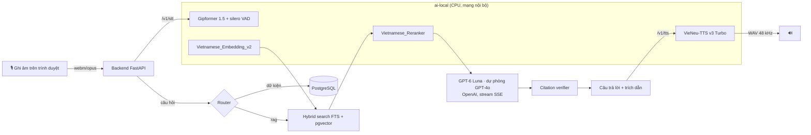

# 11 — Công nghệ AI cho CultureAtlas (tiếng Việt)

> Research và đo thực tế ngày 05/11/2026 trên máy dev: Intel Core Ultra 9 285, 24 luồng, 30 GB RAM, không có GPU rời.

**Quyết định đã chốt:**
- **Core AI (LLM) chỉ dùng OpenAI:**
  - **`gpt-6-luna`** là model chính, dùng `reasoning_effort: none`.
  - **`gpt-4o`** là model dự phòng: tự chuyển sang khi Luna lỗi mạng hoặc quá tải. Xem phần 3.
- **Mọi phần AI khác chạy local, miễn phí, mã nguồn mở**: nhận dạng giọng nói, đọc văn bản, embedding, rerank. Các phần này nằm trong dịch vụ [src/ai-local](../src/ai-local).

## 1. Kiến trúc



Âm thanh của người dùng **không rời khỏi máy chủ**:
- Dịch vụ AI local xử lý âm thanh rồi xoá ngay (AC21.3).
- Chỉ phần văn bản câu hỏi và các đoạn bằng chứng được gửi tới OpenAI.

## 2. Lựa chọn model local

| Khâu | Model | Giấy phép | Kích thước | Đo trên máy dev |
|---|---|---|---|---|
| **Nhận dạng giọng nói (STT)** | [g-group-ai-lab/gipformer1.5-68M-rnnt](https://huggingface.co/g-group-ai-lab/gipformer1.5-68M-rnnt) (Zipformer RNN-T, ONNX int8) + [silero VAD](https://github.com/k2-fsa/sherpa-onnx) qua `sherpa-onnx` | MIT | 68M | 7 giây âm thanh → **0.16–0.19 s** |
| **Đọc văn bản (TTS)** | [VieNeu-TTS v3 Turbo](https://github.com/pnnbao97/VieNeu-TTS) (ONNX, int8 nhờ AVX-VNNI), 25 giọng Bắc/Nam, 48 kHz | Apache 2.0 | ~100M | RTF **0.4–0.7** (nhanh hơn thời gian thực) |
| **Embedding** | [AITeamVN/Vietnamese_Embedding_v2](https://huggingface.co/AITeamVN/Vietnamese_Embedding_v2) (ONNX, CLS + chuẩn hoá L2) | Apache 2.0 | 568M, 1024 chiều | 5 câu → 74 ms; nhận ra câu tiếng Anh cùng nghĩa |
| **Rerank** | [AITeamVN/Vietnamese_Reranker](https://huggingface.co/AITeamVN/Vietnamese_Reranker) (cross-encoder) | Apache 2.0 | 568M | 32 đoạn → 0.69 s |

Tổng dung lượng model khoảng 5 GB. Khi đã nạp đủ cả bốn model, dịch vụ dùng khoảng 5–6 GB RAM.

### Vì sao chọn các model này (so sánh WER, tỉ lệ lỗi từ, càng thấp càng tốt)

Số liệu lấy từ bảng của dự án Gipformer.

| Model STT | Tham số | VIVOS | Common Voice | Tổng đài khó (tele-hard-N) | Giấy phép |
|---|---|---|---|---|---|
| **gipformer1.5-68M** ✅ | 68M | 4.25 | 6.45 | 26.24 | **MIT** |
| chunkformer-large-vie | 110M | 4.18 | 6.94 | 46.30 | CC BY-NC ✗ |
| Zipformer-30M-RNNT-6000h | 30M | 4.55 | 4.16 | 38.13 | CC BY-NC-ND ✗ |
| PhoWhisper-large | 1.5B | 4.73 | 8.60 | 50.39 | BSD |
| Qwen3-ASR-1.7B | 1.7B | 7.17 | 10.76 | 46.80 | Apache 2.0 |

- Gipformer có kết quả tốt nhất hoặc gần tốt nhất trên phần lớn bộ test, đặc biệt với giọng nói có nhiễu.
- Model nhỏ (68M) nên chạy nhanh trên CPU.
- Hai model tốt tương đương bị loại vì giấy phép **cấm dùng thương mại**.
- PhoWhisper có kích thước gấp 20 lần nhưng tỉ lệ lỗi lại cao hơn.

**TTS:** VieNeu-TTS v3 Turbo được chọn vì:
- Là model mở mới nhất (bản v4 không mở mã nguồn).
- Chạy trên CPU nhanh hơn thời gian thực, âm thanh 48 kHz, có sẵn giọng Bắc và Nam.
- Đã có chuẩn hoá số và ngày tháng (25/12/2026 được đọc thành "hai mươi lăm tháng mười hai…").

Các phương án khác:
- viXTTS và XTTS-v2: mất khoảng 5–6 giây mới ra âm thanh đầu tiên trên CPU.
- Piper: giấy phép GPL-3.0.
- Bản VieNeu 0.3B cũ: giấy phép CC BY-NC.

### Hạn chế đã biết

- Gipformer trả chữ **thường, không có dấu câu**. Mình đã viết hoa chữ cái đầu. Với câu hỏi gửi cho LLM thì không ảnh hưởng.
- Từ mượn tiếng Anh và tên riêng có thể bị nhận sai theo âm, ví dụ "omiyage". Vì vậy UI cho người dùng **sửa văn bản trước khi gửi** (AC21.6).
- Khi chạy thử khép kín (TTS rồi STT), có vài từ bị nhận nhầm ("quà thường" → "hòa thượng"). Cần thu 30–50 câu hỏi do người thật nói để đo WER thực tế.

## 3. Core AI — GPT-6 Luna (chính) và GPT-4o (dự phòng)

### So sánh thực tế (05/11/2026)

Cùng một prompt RAG: 3 đoạn bằng chứng tiếng Anh từ JNTO, câu hỏi tiếng Việt "khi được mời tới nhà đồng nghiệp ở Nhật thì tặng quà cần lưu ý gì? So với Việt Nam khác gì?".

| | `gpt-6-luna` (`reasoning_effort: none`) | `gpt-4o` (`temperature: 0.4`) |
|---|---|---|
| TTFT | **1.28 s** | 3.34 s (vượt mục tiêu 3 s) |
| Tổng thời gian | 4.2 s | 5.8 s |
| Tuân thủ "có nguồn mới khẳng định" | ✅ Nói rõ "chưa đủ nguồn" để so sánh với Việt Nam; nêu phạm vi của nguồn | ❌ Tự khẳng định Việt Nam "cũng dùng hai tay", không có nguồn |
| Trích dẫn `[c#]` | Đầy đủ | Đầy đủ |
| Câu hỏi gợi ý | Đúng hướng, người dùng có thể hỏi tiếp | Lạc hướng (hỏi ngược người dùng) |
| JSON theo schema (strict) | ✅ 1.8 s | ✅ 1.4 s |
| **Giá** (1M token vào / ra) | **$0.10 / $0.50** (cache $0.01) | $2.50 / $10.00 |

**Kết luận:** dùng Luna làm model chính vì rẻ hơn khoảng 20–25 lần, nhanh hơn và bám nguồn tốt hơn. GPT-4o làm dự phòng.

### Cách adapter hoạt động ([llm_adapter.py](../src/backend/app/ai/llm_adapter.py))

- **Tham số theo model:**
  - Luna là model suy luận: **không** nhận `temperature`; dùng `reasoning_effort` (`none` | `low` | `medium` | `high`; không có `minimal`).
  - GPT-4o dùng `temperature`.
- **Chuyển sang dự phòng** chỉ khi có lỗi tạm thời (mạng, timeout, 429, 5xx) và **chưa gửi chữ nào** cho người dùng. Điều này tránh câu trả lời bị ghép từ hai model.
- **Không chuyển** khi gặp lỗi 400/401 (sai tham số, sai key), vì đổi model cũng không sửa được lỗi đó.
- `last_model` ghi lại model thực sự đã trả lời, để lưu vào `chat_logs.model`.
- `ALLOWED_LLM_MODELS` chỉ cho phép `gpt-6-luna` và `gpt-4o`. Đặt model khác trong `.env` thì app báo lỗi ngay khi khởi động.
- Stream dùng cho câu trả lời. `json_schema` (strict) dùng cho so sánh, câu hỏi gợi ý và nháp quiz.
- **Router không gọi LLM:** câu hỏi dữ kiện được trả lời thẳng từ DB. Nhờ vậy giảm chi phí và giữ được TTFT < 3 s.
- **Câu hỏi gợi ý:** sinh **sau** khi đã stream xong câu trả lời.

### Văn tiếng Việt tự nhiên (bằng chứng phần lớn là tiếng Anh)

| Nguyên tắc trong prompt | Ví dụ |
|---|---|
| Đọc bằng chứng, rồi **viết lại bằng lời của mình**, không dịch từng câu | ❌ "Nó được coi là thô lỗ để…" → ✅ "Ở Nhật, … bị xem là bất lịch sự" |
| Xưng "mình", gọi người dùng là "bạn"; câu ngắn | "Nếu bạn được mời tới nhà người Nhật, …" |
| Tránh lạm dụng câu bị động "được/bị" và chuỗi "của… của…" | |
| Thuật ngữ gốc đặt trong ngoặc | "quà mang về (omiyage)" |
| Có so sánh với Việt Nam khi có bằng chứng | "Khác với lì xì ở Việt Nam, …" |
| Câu trả lời sẽ được đọc thành tiếng, nên hạn chế bảng và ký hiệu | Danh sách ngắn, mỗi ý một câu |

- Thêm 3–5 ví dụ mẫu do biên tập viên người Việt viết. Với GPT-4o, đặt `temperature` khoảng 0.3–0.5.
- **Đo chất lượng:**
  - Chạy benchmark hằng đêm với rubric "độ tự nhiên" 1–5, ngưỡng ≥ 4.0. Dùng GPT-4o làm giám khảo, vì giám khảo khác model đang được chấm sẽ đỡ thiên vị.
  - Theo dõi lượt 👍/👎.
  - Chạy test `pytest -m live` (gọi Luna và GPT-4o thật) trước khi phát hành.

## 4. Chạy và cấu hình

```bash
# Dịch vụ AI local (Python 3.12)
cd src/ai-local
python3.12 -m venv .venv && .venv/bin/pip install --extra-index-url https://download.pytorch.org/whl/cpu -e ".[rerank,dev]"
.venv/bin/python -m ai_local.download          # tải ~5 GB model, một lần
.venv/bin/uvicorn ai_local.main:app --port 8100
```

`.env` ở gốc repo:

```
LLM_PROVIDER=openai
OPENAI_API_KEY=sk-...
LLM_MODEL=gpt-6-luna
LLM_FALLBACK_MODEL=gpt-4o
LLM_REASONING_EFFORT=none
AI_LOCAL_URL=http://localhost:8100
```

Khi chạy bằng Docker Compose:
- Lần đầu tải model: `docker compose run --rm ai-local python -m ai_local.download`.
- Model lưu trong volume `ai-models`.

## 5. Hướng tăng tốc tiếp (khi cần)

- **iGPU Arc / NPU của Core Ultra:** chuyển embedding và reranker sang OpenVINO. Dự kiến rerank nhanh hơn 2–4 lần, nhưng cần đo lại.
- **Stream TTS:** `infer_stream` của VieNeu cho phép phát âm thanh trong lúc vẫn đang sinh, giúp giảm độ trễ cảm nhận.
- **STT realtime:** sherpa-onnx hỗ trợ stream qua WebSocket. Cần bản Zipformer streaming, mà Gipformer hiện mới có bản offline.

## Nguồn

- [Gipformer — bảng WER và mã](https://github.com/ggroup-ai-lab/gipformer) · [ChunkFormer](https://huggingface.co/khanhld/chunkformer-ctc-large-vie) · [PhoWhisper](https://arxiv.org/pdf/2406.02555) · [Vietnamese ASR: A Revisit](https://arxiv.org/html/2603.14779)
- [VieNeu-TTS](https://github.com/pnnbao97/VieNeu-TTS) · [VieNeu-TTS v3 Turbo trên CPU](https://alphasignal.ai/news/open-source-vieneu-tts-v3-turbo-runs-48-khz-vietnamese-speech-on-cpus) · [ZeroTTS (bảng so sánh viXTTS)](https://github.com/zeroweight-ai/ZeroTTS)
- [Vietnamese_Embedding_v2](https://huggingface.co/AITeamVN/Vietnamese_Embedding_v2) · [Vietnamese_Reranker](https://huggingface.co/AITeamVN/Vietnamese_Reranker) · [EACL 2026 — Vietnamese retrieval](https://aclanthology.org/2026.findings-eacl.110v2.pdf) · [VN-MTEB](https://arxiv.org/abs/2507.21500)
- [SEACrowd — translationese](https://arxiv.org/pdf/2406.10118) · [soe-vinorm (chuẩn hoá văn bản)](https://pypi.org/project/soe-vinorm/)
