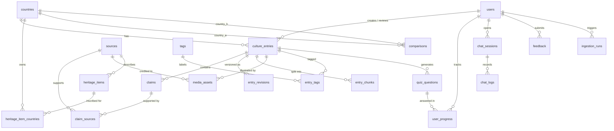
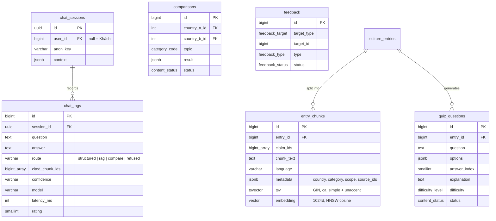
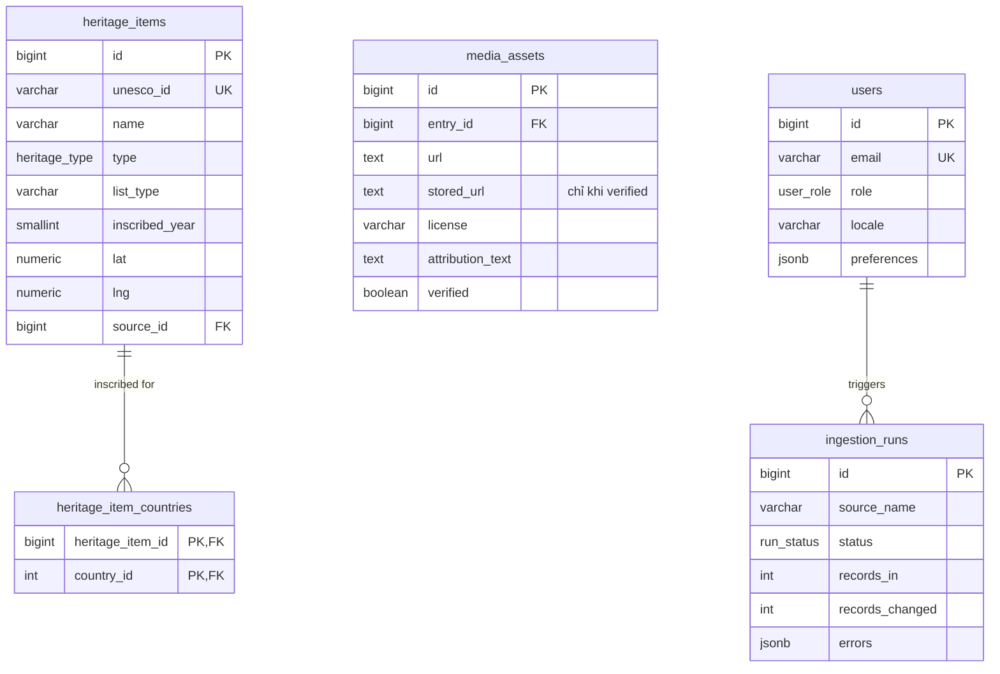

# Sơ đồ cơ sở dữ liệu (ER — Mermaid)

PostgreSQL 16 + pgvector. Nguồn sự thật: [culture_atlas.dbml](../src/database/culture_atlas.dbml) · Schema chạy được: [culture_atlas.sql](../src/database/culture_atlas.sql) · Từ điển dữ liệu: [05-data-model.md](05-data-model.md).

## 1. Toàn cảnh

## 2. Lõi nội dung có nguồn

```mermaid
erDiagram
    countries {
        int id PK
        char iso2 UK "ISO 3166-1 alpha-2"
        char iso_numeric UK
        varchar name_vi
        varchar name_en
        varchar region
        varchar capital
        jsonb languages
        jsonb currencies
        jsonb raw_data "snapshot REST Countries"
    }
    culture_entries {
        bigint id PK
        int country_id FK
        category_code category
        varchar title_vi
        text summary
        content_status status
        content_origin origin
        int version
        bigint reviewed_by FK
    }
    claims {
        bigint id PK
        bigint entry_id FK
        text text
        claim_scope scope
        varchar region "bắt buộc khi regional"
        confidence_level confidence
        content_status status
    }
    claim_sources {
        bigint claim_id PK,FK
        bigint source_id PK,FK
        text evidence_excerpt
        varchar locator
    }
    sources {
        bigint id PK
        varchar title
        varchar publisher
        text source_url UK
        source_type source_type
        varchar license
        reliability_tier reliability_tier
        date retrieved_at
    }
    entry_revisions {
        bigint id PK
        bigint entry_id FK
        int version
        jsonb snapshot
        bigint changed_by FK
    }
    countries ||--o{ culture_entries : has
    culture_entries ||--o{ claims : contains
    claims ||--|{ claim_sources : "≥1 khi published"
    sources ||--o{ claim_sources : supports
    culture_entries ||--o{ entry_revisions : versions
```

## 3. RAG, AI và phản hồi

## 4. Dữ liệu ngoài và vận hành

